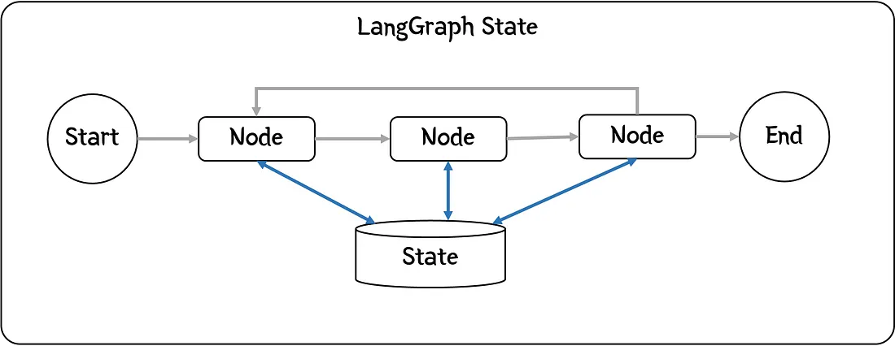
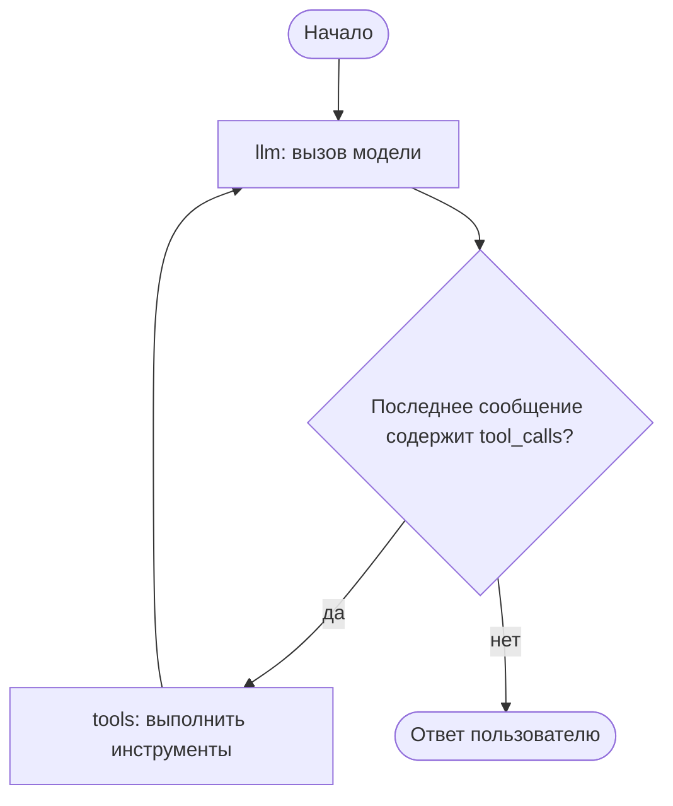

# LangGraph: графы для агентских систем

**LangGraph** — библиотека для построения агентских систем как графов рабочего процесса (workflow graph). 

См. примеры реализации простого агентского цикла и вызова инструментов (Тема 2 курса), а также примеры работы с LLM через пакет `ollama` ([ollama_python.md](ollama_python.md)) или OpenAI.


## Место LangGraph в разработке LLM-приложений

В примере `agent.py` агентский цикл написан вручную: цикл `for`, проверка `tool_calls`, добавление сообщений в историю. Такой код легко понять, но в реальном приложении быстро появляются требования, которые подобный цикл не покрывает. Например сохранить состояние между запусками и обработать сбой, прервать выполнение для одобрения человеком, отладить многошаговую траекторию. Всё это пришлось бы писать самостоятельно.

LangGraph — библиотека оркестрации агентов от команды LangChain (репозиторий `langchain-ai/langgraph`, лицензия MIT). 

Библиотека строится на идее, что агент — это **граф**. Узлы (nodes) — обычные функции (вызов модели, выполнение инструмента), рёбра (edges) — переходы между ними. К графу добавляется общее **состояние** (state) — объект, который узлы читают и обновляют. Граф компилируется в исполняемый объект, умеющий сохранять состояние, останавливаться и возобновляться.

LangGraph — де-факто стандарт для агентов. Он даёт контроль над потоком выполнения, которого не дают цепочки LangChain. Среди фреймворков он занимает нишу, в которой принято задавать *явный граф*. 

TODO: коротко про аналоги


## Связь с LangChain

LangChain и LangGraph — части одной экосистемы, но решают разные задачи. LangChain даёт составные элементы: модели (`ChatOllama`, `ChatOpenAI`), инструменты (декоратор `@tool`), промпты, интеграции с векторными БД и сервисами. LangGraph — фреимворк, который соединяет эти элементы в граф с состоянием и циклом. Он использует интерфейсы LangChain — сообщения, инструменты, чат-модели, — поэтому код из конспекта [lang-chain.md](../../tools/lang-chain.md) работает в узлах графа без изменений.

Вокруг них — общая инфраструктура. **LangSmith** — трассировка и оценка LLM-приложений, **LangGraph Platform** — развёртывание графов как сервисов. LangGraph можно использовать и без LangChain (с любой чат-моделью), но чаще они используются вместе.


## Ключевые концепции

- **Граф** — узлы (nodes) — функции `(state) -> обновления`; рёбра (edges) — переходы между узлами; условные рёбра (conditional edges) — функция, которая по состоянию решает, в какой узел идти дальше.
- **Состояние (State)** — TypedDict (или Pydantic-модель): схема данных, которые узлы читают и обновляют. Редукторы (reducers) задают, как применять обновления: по умолчанию ключ перезаписывается, `Annotated[list, operator.add]` — добавляет элементы. `MessagesState` — готовая схема с ключом `messages` и редуктором `add_messages`.
- **START и END** — специальные узлы входа и выхода графа.
- **Чекпоинты (checkpointers)** — сохраняют состояние после каждого шага; `thread_id` в конфигурации отличает один «разговор» от другого и позволяет возобновить выполнение. `MemorySaver` хранит состояние в памяти, `SqliteSaver`/`PostgresSaver` — на диске.
- **Human-in-the-loop** — `interrupt()` останавливает граф и ждёт решения человека (одобрить действие, поправить аргументы); продолжение — через `Command(resume=...)`.
- **Готовые компоненты** — `ToolNode` (узел, выполняющий `tool_calls` из последнего сообщения) и `create_react_agent` (готовый агентский цикл в одну строку).




## Установка

```bash
uv pip install langgraph langchain langchain-ollama
```

Для запуска примера нужен работающий Ollama с моделью `qwen3.5:0.8b` (см. [ollama_python.md](ollama_python.md)).


## Пример: агентский цикл (ReAct) на LangGraph

Соберём того же агента, что в `agent.py`. Используем те же инструменты, ту же модель, но цикл «цель → действие → наблюдение» станет графом. Узел `llm` вызывает модель, условное ребро направляет выполнение в узел `tools`, если модель запросила инструмент, иначе — к ответу.



```python
from langchain.tools import tool
from langchain_ollama import ChatOllama
from langgraph.graph import StateGraph, START, END, MessagesState
from langgraph.prebuilt import ToolNode

MODEL = "qwen3.5:0.8b"


# @tool превращает функцию в инструмент LangChain: docstring становится
# описанием, которое модель видит при выборе инструмента
@tool
def get_weather(city: str) -> str:
    """Return the current weather in a city.

    Use this tool when the user asks about the weather.

    Args:
        city: name of the city, for example "Moscow"
    """
    fake_data = {"Moscow": "+5 °C, облачно", "Sochi": "+22 °C, солнечно"}
    return fake_data.get(city, f"нет данных о погоде в {city}")


@tool
def calculate(expression: str) -> str:
    """Evaluate an arithmetic expression and return the result.

    Use this tool for any calculations instead of computing in your head.

    Args:
        expression: arithmetic expression, for example "2 + 2 * 3"
    """
    allowed = set("0123456789+-*/(). ")
    if not set(expression) <= allowed:
        return "ошибка: допустимы только цифры и знаки + - * / ( )"
    return str(eval(expression, {"__builtins__": {}}, {}))


TOOLS = [get_weather, calculate]

# bind_tools передаёт модели описания инструментов — она может попросить их вызвать
llm = ChatOllama(model=MODEL, temperature=0.0, reasoning = True ).bind_tools(TOOLS)

# bind_tools(): -> Runnable


def llm_call(state: MessagesState):
    """LLM decides whether to call a tool or answer."""
    # Узел читает состояние и возвращает обновления; add_messages добавляет ответ в историю
    messages = state["messages"]
    result = llm.invoke(messages)
    return {"messages": [result]}


def should_continue(state: MessagesState):
    """Route to tools if the last message asks for a tool call."""
    # Условное ребро: по состоянию решает, в какой узел идти дальше
    return "tools" if state["messages"][-1].tool_calls else END


# Собираем граф: узлы — это функции, рёбра — переходы
builder = StateGraph(MessagesState)

# добавление узлов
builder.add_node("llm", llm_call)
# "llm" -- задаёт имя узла в графе, оно может быть произвольным;
# llm_call -- функциональный объект, вызывающий LLM

# ToolNode выполняет все tool_calls из последнего сообщения (оба инструмента — в одном узле)
builder.add_node("tools", ToolNode(TOOLS))
builder.add_edge(START, "llm")
builder.add_conditional_edges("llm", should_continue, ["tools", END])
# Цикл: после инструментов управление возвращается модели
builder.add_edge("tools", "llm")

agent = builder.compile()

result = agent.invoke({
    "messages": [{"role": "user", "content": "Какая погода в Москве? И сколько будет 17 * 23?"}]
})
# Итоговое состояние хранит всю историю сообщений
for m in result["messages"]:
    m.pretty_print()
```

Основной класс — [`StateGraph`](https://reference.langchain.com/python/langgraph/graph/state/StateGraph)

**Инструменты** — те же `get_weather` и `calculate` из `agent.py`, обёрнутые декоратором `@tool`: docstring превращается в описание инструмента для модели, а функция — в объект `Tool`.

**Модель** — `ChatOllama` с той же моделью `qwen3.5:0.8b`; `bind_tools(TOOLS)` подключает инструменты, и модель получает их описания при каждом вызове.

**Узел `llm`** — обычная функция: вызывает модель с историей сообщений из состояния и возвращает ответ модели как обновление ключа `messages`. Редуктор `add_messages` добавляет сообщение в историю.

**Условное ребро `should_continue`** — сердце цикла: если последнее сообщение содержит `tool_calls`, модель попросила выполнить инструмент, идём в узел `tools`; иначе — в `END`.

**Узел `tools`** — готовый `ToolNode`. Оба инструмента, `get_weather` и `calculate`, живут в одном узле: `ToolNode` выполняет все `tool_calls` из последнего сообщения (даже если модель попросила вызвать оба инструмента сразу) и возвращает результаты как сообщения роли `tool`.

**Сборка и запуск** — `add_node`, `add_edge`, `add_conditional_edges` описывают граф, `compile()` собирает его в исполняемый объект. Цикл — это ребро `tools -> llm`: после выполнения инструментов управление возвращается модели. `invoke` запускает граф и возвращает итоговое состояние — всю историю сообщений.

Сравните с `agent.py`: там цикл и проверка `tool_calls` написаны вручную, здесь они стали рёбрами графа. Взамен LangGraph даёт бесплатно: сохранение состояния (чекпоинты), стриминг шагов, визуализацию графа (`agent.get_graph().draw_mermaid_png()`) и паузы для человека.


## Что дальше

- **`create_react_agent(model, tools)`** из `langgraph.prebuilt` — тот же агентский цикл в одну строку; удобно, когда граф не нужно настраивать.
- **Память между запросами** — чекпоинтер + `thread_id`: агент «помнит» прошлые диалоги; долгосрочная память — векторные БД (связь с темой RAG).
- **Мультиагентные паттерны** — оркестратор-воркеры, конвейер: несколько агентов в одном графе (Тема 8 курса).
- **Human-in-the-loop** — `interrupt()` для одобрения действий человеком.
- **Ограничения** — крутая кривая входа; API быстро меняется, сверяйтесь с документацией; для простых задач граф избыточен — хватит `agent.py`.


## Источники и вопросы для самопроверки

Официальная документация: [LangGraph Quickstart](https://docs.langchain.com/oss/python/langgraph/quickstart), [репозиторий LangGraph](https://github.com/langchain-ai/langgraph).

Вопросы для самопроверки:

1. Чем граф LangGraph отличается от цепочки (chain) в LangChain?
2. Зачем нужны редукторы? Что произойдёт, если два узла обновят один и тот же ключ состояния?
3. Что такое `thread_id` и зачем он нужен чекпоинтеру?
4. Как в примере реализован цикл ReAct «мысль → действие → наблюдение»?
5. В каком случае агентский цикл на LangGraph избыточен?
