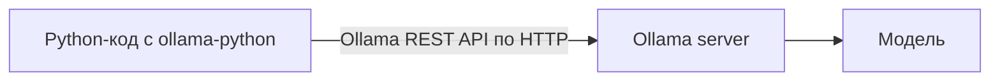

# Пакет `ollama` для Python

## 1. О пакете: область применения и границы

### Место среди библиотек для работы с LLM

- `ollama-python` — **клиент конкретного API**, а не универсальный клиент ко всем LLM-провайдерам.
- Он отправляет запросы в формате **Ollama REST API** и знает его маршруты (`/api/chat`, `/api/generate`, `/api/embed`, управление моделями и др.). `Client(host=...)` меняет адрес сервера, но не превращает запросы в OpenAI API.
<!--- Поэтому важен не только провайдер или приложение, но и **какой API-протокол оно предоставляет**:

| Сервер / сервис | API, подходящий для подключения | Рекомендуемый Python-клиент |
|-----------------|----------------------------------|-----------------------------|
| Ollama локально или Ollama Cloud | Ollama REST API | `ollama-python` |
| LM Studio | OpenAI-совместимый API (`/v1`) или собственные API LM Studio | `openai` для `/v1`, либо `lmstudio-python` для возможностей LM Studio |
| OpenRouter | OpenAI-совместимый API (`https://openrouter.ai/api/v1`) | `openai` или обычный HTTP-клиент |
| Другой провайдер | Зависит от его API: OpenAI-совместимого, Anthropic или собственного | Совместимый клиент или официальный SDK провайдера |


Пример для OpenRouter через OpenAI-клиент (установите `openai` и задайте переменную окружения `OPENROUTER_API_KEY`):

```bash
uv pip install openai
```

```python
import os
from openai import OpenAI

client = OpenAI(
    base_url='https://openrouter.ai/api/v1',
    api_key=os.environ['OPENROUTER_API_KEY'],
)

response = client.chat.completions.create(
    model='идентификатор-модели-в-OpenRouter',
    messages=[{'role': 'user', 'content': 'Привет!'}],
)
print(response.choices[0].message.content)
```

Для LM Studio используется тот же OpenAI-клиент, но локальный адрес `base_url='http://localhost:1234/v1'` и идентификатор загруженной в LM Studio модели. Если на сервере включена авторизация, передайте настроенный ключ; локально ключ может быть не нужен.

### Насколько универсален пакет `openai`

- Пакет `openai` можно считать **частично универсальным клиентом**: один и тот же интерфейс подходит к OpenAI и к другим сервисам, если они реализуют совместимый с OpenAI API. Адрес сервера задаётся через `base_url`, а модель и учётные данные — по правилам выбранного сервиса.
- Обычно можно переиспользовать базовые вызовы чата (`client.chat.completions.create(...)`), но это не гарантирует полной взаимозаменяемости. Сервисы могут поддерживать разные параметры, модели, инструменты, форматы ответа, эмбеддинги и потоковые режимы.
- SDK `openai` не превращает произвольный API в OpenAI-совместимый. Если у провайдера только собственный протокол, нужен его официальный клиент или адаптер.
- Если приложение должно переключаться между большим числом провайдеров, можно применить слой вроде LiteLLM. Он предоставляет общий интерфейс и адаптирует запросы, но отдельные функции всё равно зависят от провайдера и модели.
- Итого: `openai` — удобная отправная точка для **OpenAI-совместимых API**, а не универсальный стандарт для всей экосистемы LLM.

### Область применения и ограничения

- Подходит, когда приложение использует **Ollama** и нужны её модели, потоковая генерация, чат, эмбеддинги, инструменты, структурированный вывод или управление моделями.
- Особенно удобен для учебных и локальных проектов: один API-клиент, локальный инференс, возможность работать без отправки запросов стороннему облачному провайдеру.
- Не является универсальным слоем, который автоматически переключает запросы между Ollama, LM Studio, OpenRouter, OpenAI и другими провайдерами.
- Не гарантирует одинаковые возможности и результаты между моделями: параметры, JSON-режим, tools, изображения и reasoning зависят от API-сервера и конкретной модели.
- Для общего интерфейса к множеству провайдеров можно рассмотреть OpenAI SDK (если все целевые сервисы имеют совместимый API), SDK каждого провайдера или библиотеку-адаптер, например LiteLLM. Универсальный интерфейс обычно не покрывает все специфические функции провайдеров.
- Не путайте направления совместимости: **Ollama сама предоставляет частичную совместимость с OpenAI API**, поэтому к Ollama можно обращаться OpenAI-клиентом. Это не означает, что `ollama-python` умеет обращаться к любому серверу с OpenAI-совместимым API.-->

### Что такое Ollama и `ollama-python`

- **Ollama** — программа для запуска больших языковых моделей. Состоит из:
  - сервера `ollama serve`, который загружает модели и выполняет инференс;
  - CLI `ollama` (`pull`, `run`, `list`, `ps`, `show`, ...).
- **`ollama-python`** — тонкий клиент к Ollama REST API. Сам модель не запускает: формирует HTTP-запросы и разбирает ответы.
- Схема взаимодействия:



Источники и подробности API ollama и схожих пакетов:
- [Ollama Python library](https://github.com/ollama/ollama-python)
- [LM Studio: OpenAI-compatible endpoints](https://lmstudio.ai/docs/developer/openai-compat)
- [OpenRouter: Quickstart](https://openrouter.ai/docs/quickstart)
- [Ollama: OpenAI compatibility](https://docs.ollama.com/api/openai-compatibility)

## 2. Установка и запуск

```bash
# Установка библиотеки
uv pip install ollama          # клиент

# запуск сервера ollama и загрузка в память LLM
ollama serve                # запуск сервера (если ещё запущен)
ollama pull qwen3:0.6b      # скачать модель
```

Проверка связи с сервером
```python
import ollama
print(ollama.list())     # покажет список скаченных LLM
```

- По умолчанию сервер принимает соединения на `http://127.0.0.1:11434`. Состояние можно проверить по этому же адресу в браузере.
- Проверить список моделей вручную: `http://127.0.0.1:11434/api/tags`
- Если сервер не запущен — клиент бросит `RequestError` (см. §13).


## 3. Архитектура пакета

- **Два равнозначных способа вызова:**
  - функции: `ollama.chat(...)`, `ollama.generate(...)`;
  - экземпляр клиента: `client = ollama.Client(...); client.chat(...)`.
- Функции — обёртка над клиентом по умолчанию:

```python
# эти вызовы эквивалентны
ollama.         chat( model='llama3.2', messages=[...] )
ollama.Client().chat( model='llama3.2', messages=[...] )
```

- **`Client`** нужен, когда требуется:
  - свой адрес сервера: `Client(host='http://gpu-server:11434')`;
  - свои заголовки: `Client(headers={'Authorization': '...'})`;
  - таймаут: `Client(timeout=120)`.
- **`AsyncClient`** — асинхронный аналог (см. §14).
- **Ответы — это pydantic-модели** (`SubscriptableBaseModel`), поэтому доступ возможен двумя способами:

```python
r = ollama.chat(...)
r.message.content          # как атрибут
r['message']['content']    # как словарь
```

- Внутри: `BaseClient._request()` формирует HTTP-запрос, разбирает JSON в pydantic-модель, при ошибке сервера бросает `ResponseError`.


## 4. Обзор API

- `chat` — диалог по списку сообщений;
- `generate` — одиночный запрос по строке;
- `embed` — векторные представления (эмбеддинги);
- `embeddings` — устаревший аналог `embed`;
- `list` — список локальных моделей;
- `ps` — запущенные (загруженные) модели;
- `show` — информация о модели (Modelfile, параметры);
- `pull` / `push` — скачать / выгрузить модель в реестр;
- `create` — создать модель из Modelfile;
- `copy` — копия модели под новым именем;
- `delete` — удалить модель;
- `version` — версия сервера.


## 5. `chat()` — диалог

```python
r = ollama.chat(
    model='qwen3:0.6b',
    messages=[
        {'role': 'system', 'content': 'Ты кратко отвечаешь.'},
        {'role': 'user',   'content': 'Что такое эмбеддинг?'},
    ],
)
print(r.message.content)
```

- `messages` — список словарей вида `{'role': ..., 'content': ...}`, где `role` — кто говорит, `content` — текст сообщения.
- **Роли сообщений:** `system` — инструкция, задающая поведение модели; `user` — сообщение пользователя; `assistant` — ответ модели (нужен при передаче истории); `tool` — результат вызова инструмента.
- Порядок сообщений задаёт ход диалога; `system` обычно идёт первым.
- Контекст диалога — это весь список `messages`; модель «не помнит» ничего между вызовами, историю нужно передавать заново.
- **Основные параметры:**
  - `model` — имя модели;
  - `messages` — список сообщений;
  - `stream` — потоковая выдача (§7);
  - `format` — структурированный вывод (§8);
  - `tools` — вызов инструментов (§9);
  - `options` — параметры генерации (§12);
  - `keep_alive` — сколько держать модель в памяти (`'5m'`, `0` — выгрузить);
  - `think` — включить/выключить «размышления» reasoning-моделей.

- **`ChatResponse`** содержит: `message`, `done`, `done_reason`, `model`, `created_at`, а также метрики `total_duration`, `load_duration`, `prompt_eval_count`, `eval_count`, `eval_duration`.


## 6. `generate()` — одиночный запрос

```python
r = ollama.generate(
    model='qwen3:0.6b',
    system='Отвечай одним предложением.',
    prompt='Что такое RAG?',
)
print(r.response)
```

- Отличия от `chat`:
  - на вход строка `prompt`, а не список сообщений;
  - ответ в поле `response`, а не `message.content`;
  - есть `raw` (не применять шаблон), `template`, `suffix` (для заполнения кода).
- **Когда что:** `chat` — диалоги, tools, история; `generate` — одиночные задачи (классификация, генерация текста).


## 7. Получение ответа по мере генерации

```python
stream = ollama.chat(
    model='qwen3:0.6b',
    messages=[{'role': 'user', 'content': 'Расскажи про Python'}],
    stream=True,
)
for chunk in stream:
    print(chunk.message.content, end='', flush=True)
```

- `stream=True` возвращает **генератор** чанков; каждый чанк — `ChatResponse` с частью текста.
- Последний чанк имеет `done=True` и метрики.
- Для `generate` — аналогично, поле `chunk.response`.


## 8. Структурированный вывод

- `format='json'` — гарантирует валидный JSON.
- `format=<JSON Schema>` — навязывает схему.
- Удобно через pydantic:

```python
from pydantic import BaseModel

class ClassLabel(BaseModel):
    label: int  # 0 — негатив, 1 — позитив

schema = ClassLabel.model_json_schema()

r = ollama.generate(
    model='qwen3:0.6b',
    system='Определи тональность. Ответ — JSON.',
    prompt='Фильм отличный, мне понравилось.',
    format=schema, think=False,
)

label = ClassLabel.model_validate_json(r.response)
print(label.label)
```

- Это тот же приём, что в `public/NLP/text_classification_llm.py`.
- Важно: `format` работает не со всеми моделями одинаково хорошо — проверяйте на своей.


## 9. Вызов инструментов (tools / function calling)

- Идея: модель не выполняет код, а **просит** вызвать функцию; вызов делает ваш код, результат возвращается модели.

```python
from random import randint

def dice(max: int) -> int:
    """бросает кубик с очками от 1 до max"""
    return randint(1, max)

messages = [{'role': 'user', 'content': 'dice 10'}]

r = ollama.chat(model='qwen3:0.6b', messages=messages, tools=[dice])

if r.message.tool_calls:
    call = r.message.tool_calls[0]
    result = dice(**call.function.arguments)      # выполняем сами
    messages.append(r.message)                    # ответ ассистента с tool_calls
    messages.append({'role': 'tool', 'content': str(result)})
    r = ollama.chat(model='qwen3:0.6b', messages=messages, tools=[dice])

print(r.message.content)
```

- `message.tool_calls` — список вызовов; у каждого `function.name` и `function.arguments` (dict).
- Цикл повторяется, пока модель не вернёт обычный ответ без `tool_calls`.
- Пример-основа: `public/examples/LLM_use/tool_calling.py`.


## 10. Эмбеддинги

```python
r = ollama.embed(model='nomic-embed-text', input=['кот', 'кошка', 'автомобиль'])
vecs = r.embeddings   # список векторов
```

- `embed` — современный метод; `embeddings` — устаревший (`input` вместо `prompt`).
- Применение: поиск похожих текстов, RAG, кластеризация.
- Близость обычно считают косинусной мерой.


## 11. Управление моделями

```python
ollama.list()                       # что скачано
ollama.ps()                         # что сейчас в памяти
ollama.show('qwen3:0.6b')           # параметры, шаблон, Modelfile
ollama.pull('llama3.2')             # скачать
ollama.create(model='my', from_='qwen3:0.6b', system='...')  # своя сборка
ollama.copy('qwen3:0.6b', 'qwen3-backup')
ollama.delete('qwen3-backup')
```

- `create` собирает модель из базовой + системный промпт + параметры (аналог Modelfile).


## 12. Параметры генерации (`options`)

- `temperature` — «креативность» (0 — детерминированно);
- `top_p`, `top_k` — сэмплирование;
- `num_ctx` — размер контекстного окна;
- `num_predict` — максимум новых токенов;
- `seed` — воспроизводимость;
- `stop` — стоп-последовательности;
- `repeat_penalty` — штраф за повторы.

```python
ollama.generate(
    model='qwen3:0.6b', prompt='...',
    options={'temperature': 0, 'num_ctx': 4096, 'seed': 42},
)
```


## 13. Ошибки и надёжность

- `ResponseError` — сервер вернул ошибку (например, модель не найдена).
- `RequestError` — не удалось соединиться (сервер не запущен).
- Практика: оборачивать вызовы в `try/except`, задавать `timeout`, при необходимости — повторные попытки.

```python
from ollama import ResponseError, RequestError

try:
    ollama.chat(model='нет-такой', messages=[{'role': 'user', 'content': 'hi'}])
except ResponseError as e:
    print('Ошибка сервера:', e)
except RequestError as e:
    print('Сервер недоступен:', e)
```


## 14. Асинхронность

```python
import asyncio
from ollama import AsyncClient

async def ask(prompt):
    r = await AsyncClient().chat(
        model='qwen3:0.6b',
        messages=[{'role': 'user', 'content': prompt}],
    )
    return r.message.content

async def main():
    answers = await asyncio.gather(ask('2+2'), ask('3+3'))
    print(answers)

asyncio.run(main())
```

- `AsyncClient` даёт `await`-методы и асинхронные генераторы при `stream=True`.
- Полезно для массовой обработки (например, классификация датасета), но упирается в пропускную способность сервера.


## 15. Основные сценарии работы

- **Классификация:** `generate` + `format=schema` + pydantic (см. §8).
- **Мини-RAG:** `embed` документов → поиск ближайших → подставить в `messages` → `chat`.
- **Агент с инструментами:** цикл из §9 с несколькими функциями.
- **Пакетная обработка:** `AsyncClient` + `asyncio.gather`.


## 16. Совместимость и альтернативы

- Ollama предоставляет **частично OpenAI-совместимый endpoint** (`/v1`). К нему можно обращаться клиентом `openai`, указав адрес Ollama; доступна не вся функциональность OpenAI.
- Конспект по официальному Python-клиенту OpenAI (тот же протокол, но `base_url` указывает на Ollama) — [«Пакет `openai` для Python»](openai_python.md).
- Это совместимость со стороны сервера Ollama. Обратное не следует автоматически: `ollama-python` ожидает Ollama REST API и не становится клиентом LM Studio или OpenRouter при смене `host`.
- Для цепочек и пайплайнов можно использовать обёртки вроде LangChain (`ChatOllama`) или LlamaIndex; они добавляют слой абстракции и не устраняют различия в возможностях моделей и API.


## 17. Типичные ошибки и советы

- Модель не скачана → `ollama pull`.
- Сервер не запущен → `ollama serve`.
- Мало `num_ctx` → длинный контекст обрезается.
- Забыли `stream=True`, но ждут поток → получают один ответ.
- `format` не поддержан моделью → мусор в JSON; проверяйте `model_validate_json`.
- Reasoning-модели «думают» долго → `think=False`, если размышления не нужны.


## 18. Вопросы для самопроверки

1. Почему `ollama-python` называют «тонким клиентом»?
2. Чем `chat` отличается от `generate`?
3. Как передать историю диалога?
4. Что делает `stream=True`?
5. Как получить гарантированный JSON по схеме?
6. Кто выполняет функцию при tool calling?
7. Чем `embed` отличается от `embeddings`?
8. Что такое `keep_alive`?
9. Как обработать недоступность сервера?
10. Когда нужен `AsyncClient`?


## 19. Ссылки

- Документация: https://github.com/ollama/ollama-python
- Ollama: https://ollama.com
- Примеры курса: `public/examples/LLM_use/`, `public/NLP/text_classification_llm.py`
