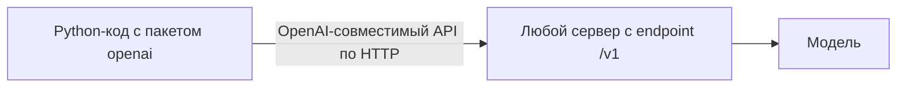

# Пакет `openai` для Python


## 1. О пакете: область применения и границы


- **`openai`** — официальный Python-клиент к REST API OpenAI. Отправляет HTTP-запросы, разбирает ответы в типизированные объекты (pydantic), поддерживает синхронный и асинхронный режимы.
- Это **тонкий клиент одного протокола**: он знает формат OpenAI API (`/v1/chat/completions`, `/v1/embeddings` и др.), но не переводит чужие протоколы в OpenAI-формат.
- Ключевая особенность — параметр `base_url`: адрес сервера задаётся вручную, поэтому тот же клиент подходит любому сервису, который **реализует OpenAI-совместимый API**.

- Универсален не пакет, а **протокол**. OpenAI-совместимый HTTP API стал де-факто стандартом, и его поддерживают локальные и облачные серверы.
- Поэтому один и тот же код работает с OpenAI, Ollama, LM Studio, OpenRouter, vLLM и др. — меняется только `base_url`, `api_key` и имя модели.
- Схема взаимодействия:




### Может ли работать не только с OpenAI?

Да. Достаточно указать `base_url` нужного сервиса:

| Сервис | `base_url` | `api_key` | `model` |
|--------|-----------|-----------|---------|
| OpenAI | по умолчанию (`https://api.openai.com/v1`) | ваш ключ | `gpt-...` |
| Ollama (локально) | `http://localhost:11434/v1` | любой, например `'ollama'` | имя модели в Ollama (`qwen3:0.6b`) |
| LM Studio (локально) | `http://localhost:1234/v1` | любой, например `'lm-studio'` | id загруженной модели |
| OpenRouter | `https://openrouter.ai/api/v1` | ключ OpenRouter | `openai/gpt-4o-mini`, `anthropic/claude-...` |

- **Локальные серверы** (Ollama, LM Studio) ключ обычно игнорируют, но пакет `openai` требует непустой `api_key` — подойдёт любая строка.
- **OpenRouter** — агрегатор: один ключ и один адрес дают доступ к моделям разных провайдеров.


### Насколько полна совместимость

- Совместимость **частичная**: базовый чат (`chat.completions.create`) работает почти везде, но часть параметров и возможностей (tools, structured output, эмбеддинги, специфичные поля ответа) зависит от сервера и модели.
- Некоторым сервисам (например, OpenRouter) можно передать необязательные заголовки `HTTP-Referer` и `X-Title` — они не влияют на работу, но учитываются во внутренней статистике сервиса.
- **Направление совместимости необратимо:** пакет `openai` умеет ходить к серверам с OpenAI-совместимым API; обратное неверно — сервер от этого не становится «OpenAI».
- Нативный клиент к локальному серверу Ollama и его отличия от протокола OpenAI разобраны в конспекте [«Пакет `ollama` для Python»](ollama_python.md).


## 2. Установка

```bash
uv pip install openai
```


## 3. Простой пример


### С OpenAI

```python
import os
from openai import OpenAI

# Клиент хранит адрес и ключ: создаём один раз и переиспользуем для всех запросов
client = OpenAI(api_key=os.environ['OPENAI_API_KEY'])

# create отправляет один запрос и возвращает один ответ;
# messages содержит весь контекст диалога — его нужно передавать целиком
response = client.chat.completions.create(
    model='gpt-4o-mini',
    messages=[{'role': 'user', 'content': 'Привет! Что такое эмбеддинг?'}],
)

# choices[0] — первый (обычно единственный) вариант ответа
print(response.choices[0].message.content)
```


### С Ollama (локально)

```python
from openai import OpenAI

# Тот же клиент, но base_url указывает на локальный сервер Ollama,
# который отдаёт OpenAI-совместимый endpoint /v1
client = OpenAI(base_url='http://localhost:11434/v1', api_key='ollama')

# Модель задаётся именем, под которым она скачана в Ollama
response = client.chat.completions.create(
    model='qwen3:0.6b',
    messages=[{'role': 'user', 'content': 'Привет!'}],
)

print(response.choices[0].message.content)
```

Список доступных на сервере моделей:

```python
# models.list() возвращает модели, доступные по текущему base_url
print([m.id for m in client.models.list()])
```


## Разбор примера

**Класс клиента LLM — `OpenAI`.** В нём хранятся параметры подключения: адрес сервера (`base_url`), ключ (`api_key`), таймауты и пул HTTP-соединений. Клиент не привязан к конкретной модели и сам по себе не делает запросов — это точка входа ко всем ресурсам API. Создают его один раз и переиспользуют; если нужны разные адреса (например, локальный сервер и облако), заводят отдельный клиент под каждый.

**Метод `create` выполняет один запрос.** Полный путь `client.chat.completions.create(...)` означает: взять у клиента ресурс `chat.completions` (чат-эндпоинт) и вызвать его метод `create`. Метод отправляет один HTTP-запрос и получает один ответ, то есть вызов одноразовый. Ни клиент, ни сервер по умолчанию не помнят предыдущие обращения, поэтому весь контекст диалога нужно передавать заново при каждом вызове.

**Список `messages` — это весь диалог.** Каждый элемент — словарь с полями
- `role` (кто говорит) 
- `content` (текст). 

**Роли**
- `system` задаёт системный промпт, который определяет общее поведение модели, 
- `user` — реплика пользователя, 
- `assistant` — ответ модели (нужен, когда передаётся история), 
- `tool` — результат вызова инструмента. 

Порядок сообщений имеет значение. Он задаёт ход диалога. Системный промпт `system` обычно стоит первым.

Сообщения образуют упорядоченный стек: сверху вниз — как элементы списка. Результат вызова инструмента добавляется в диалог отдельным сообщением с ролью `tool`.

```text
┌──────────────────────────────────────────┐
│ 1. role: system                          │
│    content: инструкция для модели        │
├──────────────────────────────────────────┤
│ 2. role: user                            │
│    content: вопрос пользователя          │
├──────────────────────────────────────────┤
│ 3. role: assistant                       │
│    content: запрос на вызов инструмента  │
├──────────────────────────────────────────┤
│ 4. role: tool                            │
│    content: результат инструмента        │
├──────────────────────────────────────────┤
│ 5. role: assistant                       │
│    content: ответ модели                 │
└──────────────────────────────────────────┘
```


**Что возвращает вызов create.** Результат — объект ответа, а сам текст лежит в `response.choices[0].message.content`. Поле `choices` — список вариантов ответа (по умолчанию один), `message` — сообщение модели с ролью и содержимым, `content` — его текст.


## 5. Устройство API: `client.chat.completions` и смежные ресурсы

**Ресурс (Resource)** — понятие REST. Это сущность, доступная по собственному адресу (URL), над которой выполняют действия HTTP-методами (`GET`, `POST`, `DELETE`). 

Подробнее про ресурсы, эндпоинты и методы REST API — в конспекте [«API»](https://github.com/VetrovSV/Programming/blob/master/API/readme.md).

Пакет `openai` повторяет эту структуру. Каждому ресурсу REST API соответствует объект у клиента, а HTTP-метод скрыт за именованным методом. Например, вызов `client.chat.completions.create(...)` — это `POST /chat/completions`. Части пути `chat` и `completions` задают ресурс, а `create` — действие над ним. Путь в коде повторяет дерево `клиент → ресурс → метод`.

Именно `chat.completions` поддерживает большинство OpenAI-совместимых серверов, поэтому примеры строятся на нём. Рядом у клиента есть другие ресурсы, устроенные так же. Ресурс `client.models` даёт метод `list()` — список доступных моделей (запрос `GET /models`). Ресурс `client.embeddings` даёт `create(...)` — векторные представления текста. Более новый ресурс `client.responses` даёт `create(...)`, объединяя генерацию, инструменты и мультимодальность, но сторонние серверы поддерживают его реже.

Структура ресурсов клиента:

```text
client
├── chat
│   └── completions
│       └── create(...)
├── models
│   └── list()
├── embeddings
│   └── create(...)
└── responses
    └── create(...)
```


## 6. Ссылки

- Документация: https://github.com/openai/openai-python
- API-справочник: https://platform.openai.com/docs/api-reference
- Ollama: OpenAI compatibility — https://docs.ollama.com/api/openai-compatibility
- LM Studio: OpenAI-compatible endpoints — https://lmstudio.ai/docs/developer/openai-compat
- OpenRouter: Quickstart — https://openrouter.ai/docs/quickstart
