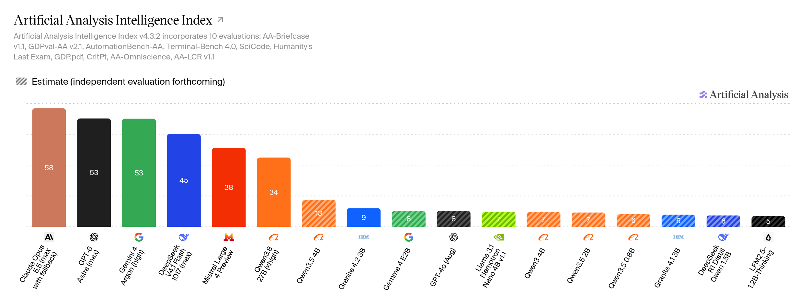

# Малые языковые модели: применимость и области применения

Малые языковые модели (small language models, SLM) — это модели с числом параметров от долей миллиарда до примерно 10 млрд, рассчитанные на работу на обычном железе: ноутбуке, телефоне, встроенной видеокарте. Они уступают большим моделям в широте знаний и глубине рассуждений, но выигрывают в скорости, стоимости, приватности и автономности. Разберём, какие задачи можно решать с помощью SLM размером до 5 миллиардов параметров.


Раздел опирается на модели, перечисленные в таблице 1. Возможности указаны сокращённо: `think` — режим пошагового рассуждения, `tools` — вызов инструментов, `vision` — обработка изображений, `audio` — обработка звука.

**Таблица 1. Малые модели, рассматриваемые в разделе**

| Модель | Год | Размер, Гб | Контекст | Возможности | Intelligence Index |
| :--- | :--- | :--- | :--- | :--- | :--- |
| [Qwen3.5 0.8B](https://ollama.com/library/qwen3.5) | 2026 | 1.3 | 256K | think, tools, vision | ≈5 |
| [Qwen3.5 2B](https://ollama.com/library/qwen3.5) | 2026 | 2.7 | 256K | think, tools, vision | ≈5 |
| [Qwen3.5 4B](https://ollama.com/library/qwen3.5) | 2026 | ~8 | 256K | think, tools, vision | ≈13 |
| [Nemotron 3 Nano 4B](https://ollama.com/library/nemotron-3-nano) | 2026 | 2.8 | 256K | think, tools | ≈7 |
| [Gemma 4 E2B (QAT)](https://ollama.com/library/gemma4) | 2026 | 4.3 | 128K | think, tools, vision, audio | 8 |
| [Granite 4.1 3B](https://ollama.com/library/granite4.1) | 2026 | 2.1 | 128K | tools | ≈4 |
| [Granite 4.2 3B](https://ollama.com/library/granite4.2) | 2026 | 2.2 | 128K | think, tools | 9 |
| [Bonsai 2 2B / 4B / 9b](https://ollama.com/library/bonsai-2) | 2026 | 0.9 / 1.6 / 3.2 | 256K | think, tools, vision | — |
| [LFM2.5 1.2B Thinking](https://ollama.com/library/lfm2.5-thinking) | 2026 | 0.7 | 32K | think, tools | ≈5 |
| [LFM3 1.7B](https://ollama.com/library/lfm3) | 2026 | 1.7 | 256K | think, tools | — |

Название модели — ссылка на страницу в библиотеке Ollama. Контекст — обученное окно модели; 256K — это 262 144 токена. Значения Intelligence Index — рейтинг [Artificial Analysis](https://artificialanalysis.ai/) версии 4.3.2 (октябрь 2026); знак `≈` отмечает оценку — независимого измерения по бенчмаркам для модели ещё нет, и балл может измениться. Размер — занимаемая память при типичной квантизации, а не исходный размер модели (см. раздел «Квантизация и качество»).




*Рисунок 1. Intelligence Index (Artificial Analysis, версия 4.3.2, октябрь 2026): от фронтирных моделей к малым. Штриховкой отмечены модели, для которых независимое измерение ещё не проведено. GPT-4o — LLM выпущенная в мае 2024 года*


## Что показывает Intelligence Index

**Artificial Analysis Intelligence Index** — сводный балл от независимой организации Artificial Analysis, которая сравнивает модели на одинаковых условиях. Это не один бенчмарк, а взвешенное среднее по десяти оценочным наборам, сгруппированным в четыре категории разного веса (версия индекса 4.3.2, сентябрь 2026):
- агентные задачи (Agents) — 30%,
- программирование (Coding) — 20%,
- общие способности (General) — 30%
- рассуждение в научных задачах (Scientific Reasoning) — 20%.

В набор входят десять бенчмарков: агентные задачи — AA-Briefcase, GDPval-AA и AutomationBench-AA; программирование — Terminal-Bench 4.0 и SciCode; общие способности — AA-Omniscience (знания и склонность к галлюцинациям), GDP.pdf и AA-LCR (длинный контекст); научное рассуждение — Humanity's Last Exam и CritPt. Итоговый балл масштабирован в диапазон 0–100.

Актуальные значения и методику удобно смотреть напрямую на [artificialanalysis.ai](https://artificialanalysis.ai/) — в разделах [Intelligence Benchmarking](https://artificialanalysis.ai/methodology/intelligence-benchmarking) и [описании индекса](https://artificialanalysis.ai/evaluations/artificial-analysis-intelligence-index).

При чтении балла важно помнить оговорки.

**Сопоставимость.** Состав наборов и веса меняются от версии к версии: в 2026 году индекс перешёл на четыре категории и заменил часть бенчмарков, которые уже попали в обучающую выборку, на бенчмарки приближенные к реальной работе. Веса категорий при этом пересматривались не раз: 25% на каждую категорию в версии 4.0, 34/24/24/18 в версии 4.1, 30/20/30/20 в версии 4.3. Поэтому баллы из разных версий индекса нельзя сравнивать напрямую.

**Стоимость балла.** Модели с режимом рассуждения набирают балл, потратив много выходных токенов. Один и тот же результат достигается разной ценой: по измерениям [Artificial Analysis](https://artificialanalysis.ai/articles/qwen3-5-small-models) (март 2026), Qwen3.5 4B расходует на прогон индекса около 240 млн выходных токенов, а вся малая серия Qwen3.5 — от 230 до 390 млн. Это больше, чем у более крупных Qwen3.5 27B (98 млн) и 397B (86 млн), и больше, чем у большинства фронтирных моделей (57–109 млн). Такая болтливость напрямую сказывается на скорости и стоимости, хотя на сам балл она не влияет.

**Общая оценка, а не специальная.** Общий балл смешивает разные способности. Для конкретной задачи важнее не он, а способность LLM решать конкретный вид задач, вызывать инструменты или поведение на длинном контексте.

**Точность для малых моделей.** Разброс на малых моделях выше, а часть оценок приблизительна (в таблице 1 отмечено `≈`). По этой причине Intelligence Index годится для грубой ориентации «какой класс задач вообще по силам», но не заменяет измерение на своей задаче.

Значения в таблице 1 относятся к версии индекса 4.3.2 (октябрь 2026) и заметно ниже, чем в ранних публикациях: например, в марте 2026 у Qwen3.5 4B было 27. Причина — смена версии: индекс сместился к более сложным агентным и прикладным задачам, где малые модели набирают меньше баллов. Поэтому балл имеет смысл сравнивать только внутри одной версии индекса.

Полезный ориентир — сравнение с большой моделью двухлетней давности. GPT-4o (май 2024) на индексе версии 4.3.2 набирает около 7 баллов — столько же, сколько модели 3–4B из таблицы 1, а Qwen3.5 4B (≈13) стоит выше. На отдельных бенчмарках малые модели уже обгоняют GPT-4o: Qwen3.5 4B выигрывает у него на MMLU-Pro (79.1 против 72.6) и GPQA Diamond (76.2 против 53.6). По знаниям и рассуждению малая модель 2026 года догнала фронтир 2024 года — примерно те самые «два года».

Но выигрыш узок и привязан к конкретным наборам. Там, где нужна широта, а не глубина одной способности, размер даёт о себе знать: малые модели проигрывают GPT-4o в коде (HumanEval у моделей этого класса — 60–73 против 90), в мультиязычности и креативном письме, чаще галлюцинируют на фактологии и менее надёжно вызывают инструменты в многошаговых агентах. Поэтому «сопоставимо с GPT-4o» верно для узкой задачи и неверно для роли универсального ассистента.


## Квантизация и качество

Малые модели почти всегда запускают в квантизованном виде: веса сжимают до 8, 4, а иногда 1–2 бит на параметр (форматы `Q8_0`, `Q4_K_M`, а у Bonsai 2 — тернарные/бинарные). Именно это сжатие позволяет уложить модель в память ноутбука или телефона и ускоряет вывод. Размер в таблице 1 — это уже квантизованный вес, а не исходный размер модели.

Обратная сторона — потеря точности. Квантизация округляет веса, и чем агрессивнее сжатие, тем сильнее падает качество. У малых моделей запас прочности меньше, чем у больших: ошибка, незаметная на модели в 70B, на 1–3B может стоить правильного ответа. Сильнее всего страдают длинные цепочки рассуждений, точное следование формату (JSON, вызов инструментов) и редкие языки.

Практические следствия:

- Бенчмарки и Intelligence Index измеряют на серверной точности (FP16/FP8), а не на бытовом `Q4`. Локально в `Q4` качество будет ниже, и это нужно проверять на своей задаче, а не переносить балл из таблицы.
- Для задач, чувствительных к формату (structured output — вывод по заданной схеме, вызов инструментов), стоит брать более высокую точность (`Q8`) или модель с запасом по размеру.
- Сверхнизкобитные модели (Bonsai 2) обучены под тернарные/бинарные веса и сохраняют качество лучше, чем обычная модель, сжатая до тех же бит. Аналогично Gemma 4 QAT (Quantization-aware Training).


## Что определяет применимость малой модели

Для применения SLM важны 4 фактора.

**Узость задачи.** Малая модель хорошо работает, когда задача сформулирована как «преобразуй вход в выход по правилу», а не «подумай и реши». Классификация, извлечение, переписывание — могут работать хорошо, а многошаговые рассуждения и открытый код — нет.

**Инструменты и внешние знания.** Вызов инструментов (function calling) поддерживают практически все малые модели — в таблице 1 он есть у всех. Поэтому это не столько свойство конкретной модели, сколько обязательная часть системы: без него модель не встроить ни в агентский цикл, ни в RAG-пайплайн с вызовом функций. Инструменты компенсируют главную слабость малых моделей — ограниченную параметрическую память (знания в весах). Нужные факты модель получает извне, а не хранит в себе.

**KV-cache и контекст.** На ограниченной памяти (порядка 16 ГБ ОЗУ) важен не только размер весов, но и служебные данные, которые создаются в момент работы LLM и хранятся в так называемом KV кэше. Размер этого кэша может быть сопоставим с размером самой LLM. Некоторые LLM (Nemotron 3 Nano, Qwen3.5, Gemma 4 E2B, LFM3) устроены так, что не создают большой кэш. У LFM3 это следствие tri-hybrid архитектуры: из 24 слоёв 13 — короткие свёртки с гейтингом, 5 — sliding-window attention и только 6 — глобальный attention; свёрточные и оконные слои не хранят KV-кэш на всю историю.

**Скорость.** Десятки токенов в секунду на встроенной графике — это интерактивный режим для одного пользователя. Для пакетной обработки (разметка, извлечение из тысяч документов) это узкое место, и там важнее пропускная способность, чем скорость в чате. С другой стороны, для задач не требующих срочности этот фактор не имеет большого значения.


## Области применения

Области применения удобно рассматривать по двум критериям.
Первый — **роль модели в пайплайне**: она либо преобразует вход в выход по правилу, либо достаёт данные, либо вызывает инструменты, либо генерирует текст.

*Чем меньше в задаче степеней свободы — когда ответ однозначно задаётся входом и правилом (классифицировать, извлечь поле, переписать по шаблону), — тем предсказуемее работает малая модель*.

И наоборот, чем планирование, несколько шагов рассуждения, генерация нового текста по произвольным правилом, работает тем хуже.

Второй критерий — **место развёртывания**: на устройстве пользователя, на edge-сервере или в частном облаке, либо в облачном каскаде рядом с большой моделью. Именно второй критерий объясняет, зачем вообще брать малую модель вместо вызова API: латентность (скорость отклика), приватность, цена на больших объёмах, работа без сети.

Рассмотрим конкретные области применения, от самой надёжного для малых моделей класса к самым рискованном.


### Преобразование текста: классификация, извлечение, нормализация

Самая массовая ниша. Задача формулируется как правило «вход → выход», у неё узкий формат ответа, таких задач много, и они часто требуют приватности. Здесь работают модели 0.3–2B.

**Классификация и маршрутизация.** Сортировка (Triage) обращений и тикетов, определение намерения (intent) в поддержке, спам и токсичность, выбор между ответом с помощью небольшой LLM и обращением к большой LLM в облаке, выбор нужного инструмента. Пример — роутер на Qwen3.5 0.8B перед облачной моделью. Быстрый первый эшелон, который отсекает простые, рутинные задачи от сложных.

**Извлечение структурированных данных.** NER (Named-entity recognition), парсинг писем, счетов и резюме в JSON, поля из форм, нормализация справочников (приведение к стандартному формату). Granite силён за счёт structured output и FIM (fill-in-the-middle — дополнение текста по контексту); у LFM есть готовые специализации `LFM2-350M-Extract` и `LFM2-1.2B-Extract`.

**Обнаружение и анонимизация персональных данных.** Найти PII (Personally Identifiable Information) и замаскировать их перед отправкой текста в облако. Готовая нишевая модель — `LFM2.5-Encoder-350M-PII-Detector`, работает на CPU без облака.

**Guardrails (рамки допустимого).** Проверки на входе и на выходе модели: на входе отсекаются попытки обхода инструкций (jailbreak), на выходе — персональные данные, токсичность, несоответствие политике. Проверка не обязана быть моделью: подойдут регулярное выражение, схема JSON или список запрещённых слов. Модерация — частный случай: классификация содержимого по категориям.

**Нормализация и орфография.** Приведение названий к справочнику, дедупликация, исправление опечаток (у Liquid — `LFM2.5-Encoder` для проверки орфографии на CPU).

**Короткий перевод.** Локальный перевод входящих сообщений и переписки; есть специализированные модели — например, `TranslateGemma` на 55 языков.


### Компоненты RAG, кроме генерации

Малая модель здесь выступает препроцессором контекста. Она дешевле и быстрее, а генерацию оставляют большой модели.

**Переформулировка запроса** (query rewriting, expansion, HyDE — Hypothetical Document Embeddings, поиск по сгенерированному ответу) — превратить вопрос пользователя в запросы к поисковику или векторной базе.

**Генерация гипотетических вопросов** к документу — чтобы поднять полноту поиска.

**Переупорядочивание найденного (reranking).** Первый этап поиска даёт приблизительный порядок чанков, второй его уточняет — и уже в таком виде контекст уходит в большую модель. Для этого есть специализированная модель `LFM2.5-ColBERT-350M`: она оценивает пару «запрос + документ» совместно и переупорядочивает результаты первого этапа, не строя собственный индекс. Для самого поиска (первый этап) есть `LFM2.5-Embedding-350M` — dense bi-encoder, один вектор на документ, самый компактный индекс.

**Извлекающий ответ (extractive QA).** Вернуть фрагмент-ответ с указанием источника, не порождая текст.


### Агентские подсистемы

В агентском пайплайне малая модель редко бывает планировщиком — чаще она берёт на себя отдельные шаги, которые повторяются много раз.

**Вызов инструментов и роутер.** Выбрать инструмент и собрать корректный вызов. Granite 4.2 обучен вызову инструментов с рассуждением (reasoning-augmented tool calling): модель обдумывает, какой инструмент вызвать и зачем; `FunctionGemma` сделан под вызов функций на устройстве; у LFM2.5 2.6B планирование и вызов инструментов — основное назначение. Свежий пример — LFM3 1.7B: он пост-обучен под агентские обвязки (Hermes Agent, Pi, OpenClaw) и заявляет сильные результаты именно на агентских бенчмарках — вызов инструментов (BFCL V4), навигация по вебу (WebArena-Verified) и автоматизация (AutomationBench) — при 1.7B параметров и ~1 ГБ памяти в 4-битной квантизации.

**Исполнитель одного шага и glue code.** Выполнить ровно один шаг и, если нужно, сгенерировать связующий код.

**Суммаризация истории (context compaction).** Сжимать длинный диалог, чтобы не переполнять контекст большой модели.

**Проверка результата.** Проверить корректность шага или черновика перед возвратом пользователю.

Направление уже оформлено концептуально: в работе «Small Language Models are the Future of Agentic AI» (arXiv 2506.02153) аргументируется, что большинство агентских подзадач узкие и повторяемые, поэтому в гетерогенной агентской системе дешевле держать специализированную малую модель на каждую роль, а большую вызывать только на сложное. Там же описан data flywheel: логи успешных шагов агента собирают и используют для дообучения экспертной малой модели.

### Генерация на узком контексте

Верхняя граница малых моделей (3–9B): здесь они уже не только преобразуют, но и порождают текст — при условии, что контекст ограничен и подставлен приложением.

**Ответ по найденному контексту.** Ответить по нескольким найденным чанкам, не выходя за них.

**Суммаризация.** Документ, встреча, длинная ветка переписки. Для длинных текстов применяют map-reduce: малая модель сжимает куски, затем — итог.

**Черновики.** Письма, ответы поддержки, описания товаров — то, что человек всё равно правит.

**Structured output и text-to-table.** Отдать результат сразу в JSON или таблицу. Так работает Phi Silica в Windows: генерация, суммаризация, переписывание и text-to-table локально на NPU.

### Код

**Автодополнение по FIM** (fill-in-the-middle) — вставить продолжение по контексту курсора; основной режим для ассистентов в редакторе.

**Тесты, объяснение, комментирование** небольших функций.

**Ревью-подсказки и сообщения коммитов.**

Полноценный coding-агент на малой модели — отдельный риск. Исключение — узкие заявления вендоров: Granite 4.2 (8B/30B) заявляет результаты на SWE-Bench Pro и Terminal-Bench, а Bonsai 2 27B по программированию почти не уступает полной точности.

### Мультимодальность и голос на устройстве

**Разбор изображений и документов.** OCR, скриншоты, PDF, чеки. У Gemma 4 E2B и E4B есть зрение и аудиовход; `LFM2.5-VL-3B` работает в браузере через WebGPU.

**Навигация по интерфейсу (computer use).** Разобрать скриншот интерфейса и решить, куда нажать. Qwen3.5 4B позиционируется как мультимодальная база для лёгких агентов: навигация по интерфейсу, разбор документов.

**Голосовой цикл STT → LLM → TTS.** Целиком локально: диктовка, голосовой ассистент, разговор без сети. На этом построены Apple Intelligence и Gemini Nano; у Liquid есть end-to-end аудиомодель `LFM2.5-Audio-1.5B`.

### Приватность как требование: on-device и on-prem

Здесь малую модель выбирают не из-за цены, а потому что данные нельзя отправлять в облако.

**Платформенные модели на устройстве.** Apple Foundation Models (~3B, iOS/macOS; с июня 2026 принимает и сторонние модели), Gemini Nano через системный сервис AICore (Pixel, Samsung: Call Notes, суммаризация в Recorder, подсказки Gboard, TalkBack, детект мошенничества в звонках), Phi Silica на Copilot+ PC.

**Отрасли.** Медицина, юриспруденция, финансы, персональная продуктивность. Требования HIPAA и GDPR прямо подталкивают к локальной обработке; отдельные доменные модели — например, `MedGemma 1.5 4B` для медицинской визуализации.

**Enterprise on-prem.** Granite лицензирован под Apache 2.0, поставляется с криптоподписью и сертификацией ISO — типичный выбор для развёртывания внутри периметра.

### Промышленность, edge и автономность

Контроль качества, предиктивное обслуживание, разбор телеметрии датчиков, offline-режим на объектах без сети, робототехника и дроны. Здесь важны миллисекунды, автономность и энергопотребление. Nemotron 3 Nano 4B сделан ровно под это: гибридная Mamba-архитектура, английский язык, работа на Jetson (Thor / Orin Nano), RTX и DGX Spark, локальные ассистенты и персоны. Gemma 4 на Raspberry Pi 5 даёт 133 prefill / 7.6 decode t/s на CPU, а на NPU Qualcomm Dragonwing — 3700 prefill / 31 decode t/s.

### Синтетические данные и разметка

Малая модель как дешёвый разметчик под присмотром большой: генерация обучающих примеров, авторазметка датасетов, дистилляция, генерация вопросов для оценки RAG. Сюда же примыкает data flywheel из агентской секции.

### Офисная и корпоративная автоматизация

Ассистент по внутренним регламентам (SOP, handbook) на локальном RAG, черновики писем, перевод входящей переписки, суммаризация встреч, FAQ-бот по базе обращений. Для небольших компаний это способ получить ИИ на своём железе и без утечки данных.

### Игры, NPC и симуляции

Реплики и описания персонажей, генерация контента без облака и подписки — там, где нужен локальный и дешёвый генератор в реальном времени.


## Классы задач по размеру модели

**Таблица 2. Сопоставление моделей с классами задач**

| Модель | II | Что реально тянет | Где ломается |
| :--- | :--- | :--- | :--- |
| Qwen3.5 0.8B | ≈5 | классификация, маршрутизация запросов, извлечение тегов и полей, детект PII, короткий перевод, автодополнение | любой многошаговый вывод, код, длинный контекст |
| Qwen3.5 2B | ≈5 | то же плюс простой экстракт в JSON, переформулировка запроса для RAG | синтез ответа по нескольким источникам |
| Qwen3.5 4B | ≈13 | ответы по контексту, суммаризация, вызов инструментов, нативное зрение, лёгкие агентские шаги, короткий код, навигация по интерфейсу | сложные агентские планы, длинный код |
| Nemotron 3 Nano 4B | ≈7 | длинный контекст при малом кэше (hybrid Mamba), поиск по документам, вызов инструментов, локальные ассистенты | глубокое рассуждение; только английский |
| Gemma 4 E2B (QAT) | 8 | мультимодальность (зрение и звук в E2B), контекст 128K, ассистент на устройстве | вызов инструментов и код слабее текстовых моделей того же размера |
| Granite 4.1 3B | ≈4 | корпоративный RAG, structured JSON, FIM, вызов инструментов | нет think — нет цепочки рассуждений |
| Granite 4.2 3B | 9 | RAG плюс агентские шаги и think, корпоративные сценарии | на 3B обучение идёт без агентских этапов, поэтому вызов инструментов на практике подводит (у 8B/30B лучше) |
| Bonsai 2 2B / 4B | — | сверхнизкобитные модели (бинарные/тернарные), think, tools и зрение, лёгкие мультимодальные задачи | — |
| LFM2.5 1.2B Thinking | ≈5 | think и tools, быстрые узкие задачи на устройстве (<1 ГБ) | низкий балл для открытых задач |
| LFM3 1.7B | — | агентские шаги и вызов инструментов (пост-обучен под агентские обвязки), 256K контекст при малом кэше, ~1 ГБ в 4-бит, быстрое дообучение под домен на одном GPU, 16 языков включая русский | знания и код: вендор прямо не рекомендует его для агентского кода и многошагового рассуждения |

Из таблицы видно общее правило: **0.8–2B — это слой преобразования текста** (классификаторы, экстракторы, роутеры, guardrails), **3–4B — это слой исполнения** (ответ по контексту, вызов инструментов, короткий код). Исключение — Qwen3.5 4B: с баллом 13 он догоняет Granite 4.2 30B (тоже 13), но платит за это длиной вывода. Ни один из классов не заменяет большую модель в роли рассуждающего планировщика.


## Специализированные модели

До сих пор речь шла о моделях **общего назначения**: одна и та же модель (Qwen3.5, Gemma 4, Granite) годится и для классификации, и для извлечения, и для ответа по контексту — меняется только промпт. Рядом с ними быстро растёт второй класс — **специализированные модели под одну задачу**: детект персональных данных, извлечение сущностей, реранкинг, перевод, вызов функций, медицинская визуализация.

Различать эти два класса стоит, но **не по размеру, а по назначению**. Размер и специализация — независимые оси: специализированной бывает и модель на 270M (`FunctionGemma`), и модель на 4B (`MedGemma 1.5 4B`), и decision-модель на 27B. Поэтому деление «SLM против LLM» (по числу параметров) и деление «общего назначения против под задачу» (по назначению) — про разное, и смешивать их не нужно.

Практический смысл различия:

- **Специализированная модель того же размера обычно точнее** на своей задаче, чем модель общего назначения: она обучена ровно под неё и часто отдаёт результат в готовом виде (метки, JSON, эмбеддинги) — без парсинга текста.
- **Но она не переиспользуется.** Её нельзя попросить о другой задаче: смена задачи означает смену модели. Модель общего назначения гибче, но на узкой задаче может проигрывать.
- **Специализированные модели часто меньше и дешевле** — 230–350M против 1–4B у моделей общего назначения, потому что им не нужны мировые знания и рассуждение.

**Таблица 3. Специализированные модели под конкретную задачу**

| Модель | Задача | Размер | Год |
| :--- | :--- | :--- | :--- |
| `LFM2-350M-Extract`, `LFM2-1.2B-Extract` | извлечение структурированных данных | 350M / 1.2B | 2025 |
| `LFM2-1.2B-Tool` | вызов инструментов | 1.2B | 2025 |
| `LFM2.5-Encoder-350M-PII-Detector` | детект персональных данных | 350M | 2026 |
| `LFM2.5-Encoder-350M` / `230M` | классификация, проверка орфографии | 350M / 230M | 2026 |
| `LFM2.5-Embedding-350M` | эмбеддинги для поиска (dense) | 350M | 2026 |
| `LFM2.5-ColBERT-350M` | реранкинг (late interaction) | 350M | 2026 |
| `LFM2.5-VL-450M-Extract` | извлечение из изображений | 450M | 2026 |
| `LFM2.5-Audio-1.5B` | аудио: распознавание и синтез речи | 1.5B | 2026 |
| `TranslateGemma` | перевод, 55 языков | 4B / 12B / 27B | 2026 |
| `FunctionGemma` | вызов функций на устройстве | 270M | 2025 |
| `EmbeddingGemma 2` | мультимодальные эмбеддинги на устройстве | 740M | 2026 |
| `MedGemma 1.5 4B` | медицинская визуализация | 4B | 2026 |

В таблице — только актуальные версии: где в 2026 году вышла замена (например, `EmbeddingGemma 2` вместо `EmbeddingGemma`), стоит она; устаревшие модели (`LFM2-1.2B-RAG`) не приводятся. Список неполный и быстро устаревает: специализированные модели выпускают под каждую нишу, и у одного вендора (Liquid) их десятки. Общий признак — модель обучена под одну задачу и не претендует на универсальность. Показателен подход Liquid в семействе LFM3 (октябрь 2026): base, text, vision, audio, omni и decision-модели построены на одном tri-hybrid бэкбоне, а под задачу модель дообучается на одном GPU — например, decision-модель d1-2B построена на мультимодальном LFM3-VL-2B.

### Decision-модели

Довольно узкий случай специализации — **decision модели** (decision models, "модели решений:). Это модели вообще не генерируют текст, а сразу возвращают решение — метку класса, число или вероятность.

**Откуда термин.** Категорию открыла модель **Jev** компании TypeSafe AI (Сан-Франциско), выпущенная 15 сентября 2026 года. Сама TypeSafe назвала класс «System One models» — по быстрому, интуитивному мышлению Системы 1 из книги Даниэля Канемана «Думай медленно… решай быстро», противопоставляя его медленному рассуждающему LLM (Система 2). Более распространённым стало название decision model.

**Как они устроены.** На вход decision-модель принимает текст, JSON, изображение или другой вид данных, а также один или несколько типизированных вопросов. На выходе модель отдаёт распределение вероятностей по заранее заданным вариантам ответа. Вопросы бывают трёх видов:

- **choice** — выбрать один вариант из списка (какая команда должна обработать тикет);
- **score** — оценить по упорядоченной шкале (срочность от 1 до 5);
- **noul** — да/нет (от Bernoulli), вероятность того, что утверждение истинно.

Все вопросы модель обрабатывает за один прямой проход (не авторегрессивно), поэтому отвечает за десятки миллисекунд и не может выдать ответ вне заданной схемы — галлюцинация и ошибка формата здесь невозможны по построению. Однако, как и у любой модели МО возможно ошибки.

**Где место decision-модели.** Она занимает нишу между классическим ML и LLM. Классификатор, обученный на своих данных, быстр и дёшев, но под каждый новый вопрос нужен новый датасет и переобучение. LLM отвечает на любой вопрос, но генерирует токен за токеном. На это тратится время и деньги, а текст ещё нужно разобрать. Decision-модель принимает вопрос на естественном языке, как обычная LLM, и отвечает как классификатор, без обучения и без последующего парсинга ответа. Такая модель закрывает потребности в задачах, для которых обычный LLM слишком дорог, а свой классификатор — слишком трудоёмок.

**Пример: бинарная классификация документа.** Задача, знакомая по курсу машинного обучения: отнести текст к одному из двух классов, например спам или не спам. Классическое решение — обучить свой классификатор на размеченных данных. Decision-модель даёт тот же результат без обучения и без разметки: документ передаётся как `state`, а классы описываются словами в поле `criteria`. Пример ниже использует открытую модель d1 локально через Ollama. Текст примера приведён на английском языке для лучшей совместимости с большинством моделей.

Подготовка — установить Ollama 0.35 или новее, скачать модель и поставить SDK:

```bash
ollama pull d1
pip install typesafe-sdk
```

Запрос через Python SDK, направленный на локальный сервер Ollama (ключ обязателен для SDK, но Ollama его игнорирует, поэтому подойдёт любая строка):

```python
from typesafe_sdk import TypeSafeClient, Choice

client = TypeSafeClient(
    base_url="http://localhost:11434",
    api_key="ollama",
)

document = """
    Dear Customer,
    We noticed unusual sign-in activity on your account. To protect your security, we have temporarily limited your access. Please verify your identity within 24 hours or your account will be permanently closed.
    [Click here to verify your account](e-corp.com/verify)
    Sincerely,
    Security Team
"""

MODEL  = "tev1:0.8b"
# https://ollama.com/library/tev1

result = client.system_one(
    model=MODEL,
    state=document,
    questions={
        "category": Choice(
            instructions="Which class does this document belong to?",
            criteria={
                "spam": "Advertising, fraud, phishing, or attempts to solicit data or money",
                "ham": "Normal business or personal correspondence",
            },
        ),
    },
)

print(result.answers["category"].choice)        # spam
print(result.answers["category"].confidence)    # 0.41
print(result.model_dump_json(indent=2))
```

Ответ
```json
spam
0.4062743341109083
{
  "model": "tev1:0.8b",
  "usage": {
    "input_tokens": 195,
    "output_tokens": 0
  },
  "answers": {
    "category": {
      "type": "choice",
      "choice": "spam",
      "confidence": 0.4062743341109083,
      "probabilities": {
        "spam": 0.7031371670554541,
        "ham": 0.2968628329445458
      }
    }
  }
}
```
- `output_tokens` всегда равен нулю. Модель не генерирует текст, весь ответ вычисляется за один прямой проход; локально вызов не стоит ничего, на hosted API — доли цента;
- кроме выбранного класса модель возвращает полное распределение и `confidence` — по ним неуверенные случаи можно отдавать человеку или большой модели;
- тот же вопрос можно задать проще, типом `noul` (да/нет): «Это спам?» вернёт одно число — вероятность того, что утверждение истинно.

Без кода модель можно быстро проверить через CLI: `ollama run tev1:0.8b --ask "Is this spam?" < document.txt`.


**Таблица 4. Decision-модели (все — сентябрь–октябрь 2026)**

| Модель | Вендор | Размер | Доступ |
| :--- | :--- | :--- | :--- |
| Jev | TypeSafe AI | — | hosted API |
| d1, d1-2B, d1-3B, d1-omni-600M | Liquid AI | 600M / 2B / 3B | API и открытые веса |
| Clef, Clef-flash | Cloudflare | 27B / 9B | Apache 2.0 |
| Strands Decider | AWS | 2B | открытые веса |
| pplx-decider | Perplexity | 27B | открытые веса |
| Microsoft-Decision-1 | Microsoft | 9B | hosted API |
| Snowflake Decision | Snowflake | — | SQL-функция |
| gpt-6-luna (Decisions API) | OpenAI | — | hosted API |
| Kev | сообщество | 0.8B / 4B / 9B | открытые веса |
| Bosun | Hanno Labs | 0.6B / 1.7B | открытые веса |

Категория сложилась за считанные недели: первый вендорский ответ на Jev появился 29 сентября, а к середине октября свои decision-модели выпустили все крупные облака и лаборатории. Почти все они говорят на одном и том же запросе-схеме (`state` + типизированные вопросы), поэтому модель за интерфейсом заменяема.

**Ограничения.** Decision-модель — это упакованный классификатор с хорошим интерфейсом и калибровкой, а не новый вид интеллекта. Она слаба на числах, датах и порядковых шкалах; её уверенность нужно калибровать на своих данных; а поскольку модель не порождает текст, манипуляцию входом труднее заметить — атака не оставляет видимого следа. Поэтому decision-модель ставят как первый эшелон перед LLM или человеком, а не как замену им.


## Каскад: локальная модель и облачная эскалация

На практике малую и большую модели объединяют в каскад. Локальная модель обрабатывает рутинные, чувствительные к задержке и приватности запросы, а сложные и редкие случаи эскалируются в облачную большую модель. Малая модель здесь работает как **роутер и первый эшелон**, большая — как **эскалация**. Такая схема объясняет и экономику (снижение стоимости API), и архитектуру: где ставить guardrails, где кэш, где запасной вариант.


## Границы применимости

Малые модели не тянут широкие мировые знания, длинные цепочки рассуждений, актуальную информацию без RAG, сложный код и многошаговое планирование. Intelligence Index в диапазоне 4–13 — честный индикатор: модель надёжна на узкой задаче и ненадёжна на открытой. Отсюда практическое правило проектирования — **декомпозировать задачу до уровня, где малая модель даёт стабильный результат**, а не ждать от неё универсальности.


## Вопросы для самопроверки

1. Почему задача «классифицировать обращение» подходит малой модели, а «спланировать многошаговую поездку» — нет?
2. Что даёт модели поддержка `tools` и почему без неё нельзя построить агентский цикл?
3. Чем измеренный Intelligence Index отличается от оценки и почему баллы из разных версий индекса нельзя сравнивать напрямую?
4. В каких случаях малую модель выбирают не ради цены, а ради приватности? Приведите пример отрасли.
5. Объясните идею каскада: какие запросы обрабатывает локальная модель, а какие эскалируются в облако?
6. Почему при пакетной обработке тысяч документов узким местом становится пропускная способность, а не скорость в чате?
7. Чем специализированная модель отличается от модели общего назначения и почему это различие не сводится к размеру?
8. Что такое decision-модель и почему название «decision LLM» неточно?
9. Кто и когда предложил термин «decision model» и почему прижилось именно это название, а не «System One»?


## Источники

- Artificial Analysis: [сайт](https://artificialanalysis.ai/), [методика Intelligence Benchmarking](https://artificialanalysis.ai/methodology/intelligence-benchmarking), [описание Intelligence Index](https://artificialanalysis.ai/evaluations/artificial-analysis-intelligence-index).
- Qwen. [Qwen3.5-0.8B](https://huggingface.co/Qwen/Qwen3.5-0.8B), [Qwen3.5-4B](https://huggingface.co/Qwen/Qwen3.5-4B) на Hugging Face.
- Google DeepMind. [Gemma 4](https://blog.google/innovation-and-ai/technology/developers-tools/gemma-4), [Gemma model card](https://ai.google.dev/gemma/docs/core/model_card_4).
- IBM. [Granite 4.2](https://www.ibm.com/granite/docs/models/granite4-2), [Granite 4.2 на Hugging Face](https://huggingface.co/ibm-granite/granite-4.2-3b).
- NVIDIA. [Nemotron 3 Nano 4B](https://huggingface.co/blog/nvidia/nemotron-3-nano-4b).
- Liquid AI. [LFM2.5-1.2B-Thinking](https://www.liquid.ai/blog/lfm2-5-1-2b-thinking-on-device-reasoning-under-1gb), [LFM2.5-2.6B](https://www.liquid.ai/blog/lfm2-5-2-6b).
- Liquid AI. [LFM3-1.7B на Hugging Face](https://huggingface.co/LiquidAI/LFM3-1.7B) (tri-hybrid архитектура, таблица бенчмарков), [обзор релиза LFM3](https://www.marktechpost.com/2026/10/27/liquid-ai-lfm3-open-weight-2b-multimodal-models) (октябрь 2026).
- Ollama. Страницы моделей из таблицы 1 (ссылки в самой таблице).
- Microsoft. [Phi Silica](https://learn.microsoft.com/en-us/windows/ai/apis/phi-silica).
- I. Belouadi и др. [Small Language Models are the Future of Agentic AI](https://arxiv.org/pdf/2506.02153).
- TypeSafe AI. [Introducing System One Models & Jev](https://typesafe.ai/), [документация Jev](https://typesafe.ai/).
- M. Appleton. [«Can we agree to call Jev a Decision Model?»](https://twitter.com/Mappletons/status/2101560333441610133) (X, 20 сентября 2026).
- S. Willison. [Jev introduces a new shape of LLM—System One, aka Decision Models](https://simonwillison.net/2026/Sep/21/jev) (21 сентября 2026).
- K. Waehner. [How Decision Models Became a New AI Category After Jev](https://www.kai-waehner.de/blog/2026/10/20/how-decision-models-became-a-new-ai-category-after-jev) (20 октября 2026).
- Wikipedia. [Jev (AI model)](https://en.wikipedia.org/wiki/Jev_(AI_model)).
- Liquid AI. [Каталог моделей LFM2.5](https://www.liquid.ai/models) (специализированные и decision-модели), [документация d1](https://docs.liquid.ai/lfm/models/d1) (формат запроса и примеры).
- Ollama. [Страница модели d1](https://ollama.com/library/d1) (эндпоинт `/v1/systemone`, CLI и примеры), [поддержка decision-моделей](https://ollama.com/blog/ollama-now-supports-jev-style-decision-models) с версии 0.35.
- Google DeepMind. [Варианты Gemma](https://deepmind.google/models/gemma) (TranslateGemma, FunctionGemma, EmbeddingGemma, MedGemma, ShieldGemma).
