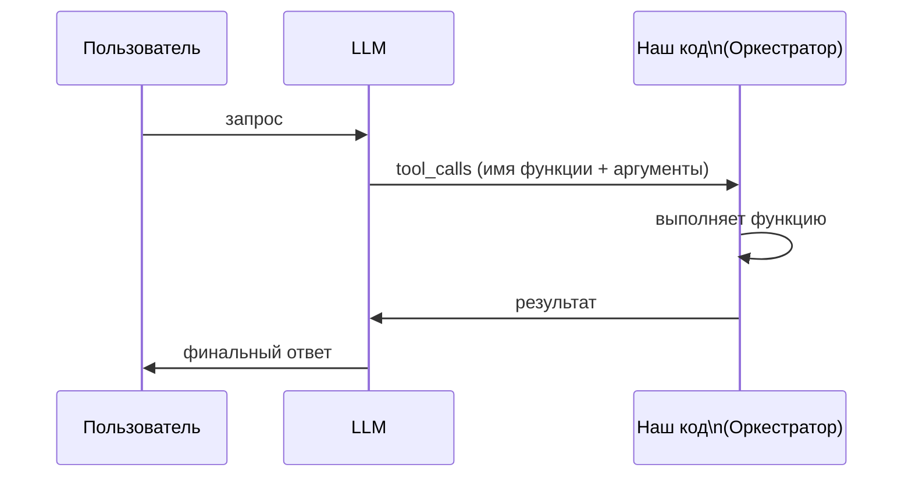
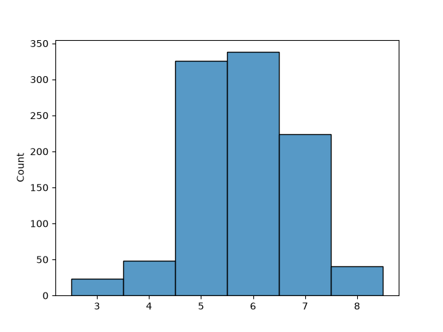

# Вызов инструментов (tool calling / function calling)

Пример показывает, как чрез LLM вызывать функции — инструменты (tools).

LLM плохо справляется с задачей генерации случайного числа. Но с ней легко справляется код на Python. Поэтому компенсируем этот недостаток, дав возможность LLM делать вызов инструмента.

## Вызов функции

LLM не выполняет функцию сама. Она:
1. понимает, что для ответа нужен инструмент;
2. генерирует текстовую команду вызова (имя функции и аргументы);
3. получает обратно результат выполнения;
4. формулирует по нему финальный ответ пользователю.

Один шаг выглядит так:



## Как это работает в коде

### Docstring = JSON-схема инструмента

`ollama-python` превращает docstring функции в JSON-схему инструмента
(описание + параметры). Чем понятнее описание и примеры, тем точнее модель
выбирает функцию и её аргументы. Поэтому в `dice` docstring подробный:
перечислены формулировки вроде `"roll a d20"` и соответствующие им значения `max`.

### Инструмент `dice`

```python
def dice(max: int) -> int:
    """Roll a die and return a random integer from 1 to max. ..."""
    if max == 0:
        return 9999          # заглушка для теста "roll d0"
    else:
        return randint(1, max)
```

Ветка `max == 0` — заглушка для крайнего случая `"roll d0"`: без неё
`randint(1, 0)` упал бы с `ValueError`.

### Две модели

В примере используются две модели:

- `MODEL_TOOLS` — выбирает инструмент и генерирует команду вызова (`qwen3.5:0.8b`)
- `MODEL_ANSWER` — формулирует финальный ответ (`qwen3.5:0.8b`)

Так можно взять быструю модель для выбора инструментов и модель получше для
текста. Но модели могут быть и одинаковыми — главное, чтобы обе были обучены
вызову инструментов и умели отвечать обычным текстом.

Модель для выбора инструментов обязательно должна быть обучена этому
(в комментарии как альтернатива указана `granite4.2:3b`).


### Два вызова `ollama.chat`

Параметр `tools` есть только у `chat` (у `generate` его нет), поэтому
используется именно `chat`.

**Первый вызов** — передаём инструменты в `tools`:

```python
r = ollama.chat(model=MODEL_TOOLS, messages=messages, tools=[dice],
                options={'temperature': 0.0})
```

Если передать `tools`, в системный промпт автоматически добавляется описание
того, что LLM должна вызывать инструмент.

**Второй вызов** — после выполнения функции просим сформулировать ответ.
Инструменты больше не передаём, иначе модель может вызвать функцию повторно
вместо ответа.

### Возврат результата в модель

После вызова инструмента в историю сообщений добавляются два хода:

```python
messages.append(r.message)  # ответ ассистента с tool_calls
messages.append({'role': 'tool', 'tool_name': call.function.name,
                 'content': str(result)})
```

Без сообщения ассистента с `tool_calls` модель не поймёт, откуда взялся
результат, и ответ может быть пустым.

## Запуск

Требуется запущенный локальный сервер [Ollama](https://ollama.com) и
установленный пакет:

```bash
pip install -r requirements.txt
python tool_calling.py
```

Скрипт прогоняет несколько формулировок из `TEST_PROMPTS`, чтобы показать,
как модель выбирает функцию и аргументы, и в конце печатает число вызовов и
ошибок.


## Крайние случаи и замечания

- `"roll d0"` — некорректный аргумент; обрабатывается заглушкой в `dice`.
- Если модель не захотела вызывать функцию, `test_call` бросает
  `Exception("No function call")` — это видно в счётчике ошибок.
- Для reasoning-моделей ответ может уйти в блок размышлений (`thinking`),
  тогда помогает параметр `think=False`.
- `qwen3.5:0.8b` в режиме рассуждений проигрывает GPT-3.5 Turbo (2023) на
  бенчмарках на 5–20 п.п. Например, на MMLU-Pro: Qwen3.5 0.8B с
  рассуждениями — 42,3 %, GPT-3.5 — 48 %.

## Случайность в LLM

Результаты генерации случайных чисел на отрезке от 1 до 10, через Qwen3.5:0.8b с температурой 1.0. По два крайних значения ни разу не выпали за 1000 запросов.



# См. также
- [Малые языковые модели их области применения](../../NLP/small_llm.md)
