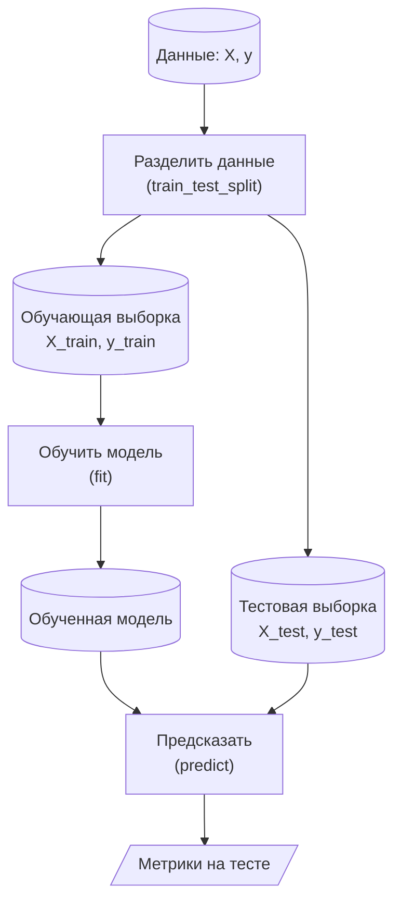

# Введение в scikit-learn (sklearn)

# 1. Что такое scikit-learn

[scikit-learn](https://scikit-learn.org/stable/) — библиотека машинного обучения на Python, построенная на NumPy и SciPy. Она реализует классические методы обучения с учителем и без учителя, а также инструменты для подготовки данных, выбора модели и оценки качества. Все алгоритмы используют единый интерфейс, поэтому, освоив один, легко перейти к другому. Для глубокого обучения sklearn не предназначена — там используют PyTorch или Keras.

Актуальная версия — **1.9.1** (сентябрь 2026).

- Установка и импорт:
  ```python
  # uv pip install scikit-learn
  import sklearn
  sklearn.__version__
  sklearn.show_versions()   # полезно для диагностики окружения
  ```

---

# 2. Основные модули

sklearn разбита на модули по назначению. Ниже — самые главные, сгруппированные по роли:

- **Данные**
  - [`sklearn.datasets`](https://scikit-learn.org/stable/api/sklearn.datasets.html) — готовые и синтетические датасеты, загрузка из OpenML (`load_iris`, `make_classification`, `fetch_openml`)
- **Подготовка данных**
  - [`sklearn.preprocessing`](https://scikit-learn.org/stable/api/sklearn.preprocessing.html) — масштабирование и кодирование признаков (`StandardScaler`, `MinMaxScaler`, `OneHotEncoder`, `OrdinalEncoder`)
  - [`sklearn.impute`](https://scikit-learn.org/stable/api/sklearn.impute.html) — заполнение пропусков (`SimpleImputer`)
- **Разделение данных и оценка модели**
  - [`sklearn.model_selection`](https://scikit-learn.org/stable/api/sklearn.model_selection.html) — разделение на train/test, кросс-валидация (`train_test_split`, `cross_val_score`, `KFold`, `StratifiedKFold`)
- **Модели машинного обучения**
  - с учителем:
    - [`sklearn.linear_model`](https://scikit-learn.org/stable/api/sklearn.linear_model.html) — линейные модели (`LinearRegression`, `LogisticRegression`, `Ridge`, `Lasso`)
    - [`sklearn.tree`](https://scikit-learn.org/stable/api/sklearn.tree.html) — деревья решений (`DecisionTreeClassifier`, `DecisionTreeRegressor`)
    - [`sklearn.ensemble`](https://scikit-learn.org/stable/api/sklearn.ensemble.html) — ансамбли моделей (`RandomForestClassifier`, `GradientBoostingClassifier`)
    - [`sklearn.neighbors`](https://scikit-learn.org/stable/api/sklearn.neighbors.html) — метод k ближайших соседей (`KNeighborsClassifier`, `KNeighborsRegressor`)
    - [`sklearn.svm`](https://scikit-learn.org/stable/api/sklearn.svm.html) — метод опорных векторов (`SVC`, `SVR`)
    - [`sklearn.naive_bayes`](https://scikit-learn.org/stable/api/sklearn.naive_bayes.html) — наивный байесовский классификатор (`GaussianNB`)
  - без учителя:
    - [`sklearn.decomposition`](https://scikit-learn.org/stable/api/sklearn.decomposition.html) — снижение размерности (`PCA`)
    - [`sklearn.cluster`](https://scikit-learn.org/stable/api/sklearn.cluster.html) — кластеризация (`KMeans`, `DBSCAN`)
- **Оценка качества**
  - [`sklearn.metrics`](https://scikit-learn.org/stable/api/sklearn.metrics.html) — метрики (`accuracy_score`, `f1_score`, `mean_squared_error`, `r2_score`)
- **Вспомогательное**
  - [`sklearn.dummy`](https://scikit-learn.org/stable/api/sklearn.dummy.html) — baseline для сравнения (`DummyClassifier`, `DummyRegressor`)
  - [`sklearn.pipeline`](https://scikit-learn.org/stable/api/sklearn.pipeline.html) — объединение шагов обработки в один объект (`Pipeline`, `make_pipeline`) —

---

# 3. Данные в sklearn

sklearn работает с **табличными данными**. Строки таблицы — объекты (наблюдения), а столбцы — их характеристики. Самый частый формат — `pandas.DataFrame`; sklearn также принимает `numpy.ndarray` и разреженные матрицы (sparse — матрицы, в которых большинство значений нули; экономят память).

Основные понятия:
- **Объект (sample)** — одна строка таблицы.
- **Признак (feature)** — характеристика объекта (столбец).
- **Целевая переменная (target)** — то, что предсказывает модель (отдельный столбец).

Данные в sklearn принято обозначать:
- `X` — матрица признаков, размерность `(n_samples, n_features)`;
- `y` — целевая переменная, размерность `(n_samples,)`.

- `n_samples` — число объектов (строк);
- `n_features` — число признаков (столбцов).

Например, датасет ирисов (`load_iris`):

| sepal length | sepal width | petal length | petal width | species |
|---|---|---|---|---|
| 5.1 | 3.5 | 1.4 | 0.2 | setosa |
| 7.0 | 3.2 | 4.7 | 1.4 | versicolor |
| 6.3 | 3.3 | 6.0 | 2.5 | virginica |
| 5.9 | 3.0 | 4.2 | 1.5 | versicolor |

Здесь 4 признака (первые четыре столбца) и целевая переменная `species`. 4 строки — 4 объекта.
В полном датасете 150 объектов: `X.shape == (150, 4)`, `y` — 150 значений вида.

- Даже один объект подаётся в predict как 2D массив:
  ```python
  model.predict([[4, 5, 6]])   # 1 объект, 3 признака
  ```
- Встроенные данные — модуль [`sklearn.datasets`](https://scikit-learn.org/stable/api/sklearn.datasets.html):
  ```python
  from sklearn.datasets import load_iris, load_diabetes          # готовые датасеты
  from sklearn.datasets import make_classification, make_regression  # синтетика
  from sklearn.datasets import fetch_openml                      # загрузка из OpenML
  ```
  Документация: [`load_iris`](https://scikit-learn.org/stable/modules/generated/sklearn.datasets.load_iris.html), [`load_diabetes`](https://scikit-learn.org/stable/modules/generated/sklearn.datasets.load_diabetes.html), [`make_classification`](https://scikit-learn.org/stable/modules/generated/sklearn.datasets.make_classification.html), [`make_regression`](https://scikit-learn.org/stable/modules/generated/sklearn.datasets.make_regression.html), [`fetch_openml`](https://scikit-learn.org/stable/modules/generated/sklearn.datasets.fetch_openml.html).
  `fetch_openml` берёт датасеты из OpenML — открытого онлайн-репозитория наборов данных для МО.

**Примеры:** [разведочный анализ и подготовка данных (Colab)](https://colab.research.google.com/drive/1kLfmJ4q81BNZtMs-oVX9cKJGsT3mYWmR), [синтетические данные и EDA (Colab)](https://colab.research.google.com/drive/18YGaumubomt-Rtg_9_VT_nf1GwbMlEx8). Датасеты курса — в папке [`datasets/`](datasets/).

---

# 4. Общий API

## Типы объектов
- **estimator** — базовый объект, содержит метод `fit` ([глоссарий](https://scikit-learn.org/stable/glossary.html#term-estimator)).
- **predictor** — содержит метод `predict` (классификатор, регрессор).
- **transformer** — содержит метод  `transform` (масштабирование, кодирование).
- **clusterer** — содержит метод  `fit_predict` (без учителя).

## Основные методы
| Метод | Что делает |
|---|---|
| `fit(X, y)` | обучает модель на данных |
| `predict(X)` | предсказывает ответ для новых данных |
| `predict_proba(X)` | вероятности классов (у классификаторов) |
| `transform(X)` | преобразует данные (у трансформеров) |
| `fit_transform(X, y)` | `fit` + `transform` за один вызов |
| `score(X, y)` | оценка качества «из коробки» |

## Соглашения
- **Гиперпараметры** — настройки модели, которые задаёт исследователь до обучения (например, `C` у логистической регрессии). Их задают в конструкторе: `LogisticRegression(C=1.0)`.
- **Параметры** — то, что модель находит сама при `fit`; они хранятся в атрибутах с `_` на конце: `coef_`, `intercept_`, `mean_`, `classes_`.
- `get_params()` / `set_params()` — чтение и изменение гиперпараметров.

## Пять шагов создания модели МО
0. Подключить класс модели.
1. Создать объект, задав гиперпараметры.
2. Обучить: `model.fit(X_train, y_train)`.
3. Предсказать: `model.predict(X_test)`.
4. Оценить качество.

```python
# Пример: линейная регрессия
from sklearn.linear_model import LinearRegression

model = LinearRegression()
model.fit(X_train, y_train)
y_pred = model.predict(X_test)
```
Документация: [`LinearRegression`](https://scikit-learn.org/stable/modules/generated/sklearn.linear_model.LinearRegression.html).

**Примеры:** [линейная регрессия (Colab)](https://colab.research.google.com/drive/1YadlNYk9_WkCQY6L-HKP9SI7xZjuzIMx). Кратко о модели — [шпаргалка по линейной регрессии](<slides etc/linreg/ML_intro_linreg.png>).

---

# 5. Разделение данных и оценка

## Зачем делить на train/test
Модель, которая «запомнила» обучающие данные, даёт идеальный результат на них, но плохой на новых — это **переобучение**. Поэтому часть данных откладывают и не показывают модели при обучении: на ней получают честную оценку того, как модель будет работать на новых данных.


Обучающая выборка используется для подбора параметров модели, тестовая — только для итоговой оценки. Поэтому `fit` вызывается только на обучающей выборке, а `predict` — на тестовой.



```python
from sklearn.model_selection import train_test_split

X_train, X_test, y_train, y_test = train_test_split(
    X, y,
    test_size=0.2,      # доля тестовой выборки
    random_state=42,    # воспроизводимость
    stratify=y,         # сохранить пропорции классов (для классификации)
)
```
Документация: [`train_test_split`](https://scikit-learn.org/stable/modules/generated/sklearn.model_selection.train_test_split.html).

## Кросс-валидация
**Кросс-валидация** — способ оценки, при котором данные по очереди делят на несколько частей (фолдов): на одних модель обучается, на оставшейся проверяется. Так получают устойчивую оценку, особенно при малом объёме данных.

```python
from sklearn.model_selection import cross_val_score

scores = cross_val_score(model, X, y, cv=5)   # 5 фолдов
scores.mean(), scores.std()
```
Документация: [`cross_val_score`](https://scikit-learn.org/stable/modules/generated/sklearn.model_selection.cross_val_score.html). Подробнее — [Cross-validation: evaluating estimator performance](https://scikit-learn.org/stable/modules/cross_validation.html).

## Утечка данных (data leakage)

- `fit` / `fit_transform` — **только на обучающей** выборке.
- `transform` — на обучающей и тестовой.
- Тестовую выборку нельзя использовать для выбора модели или настройки.

**Примеры:** [логистическая регрессия и метрики (Colab)](https://colab.research.google.com/drive/1AdbtsRkX0jRVByuAKJxchYPcciTgFpqh), [kNN и кросс-валидация (Colab)](https://colab.research.google.com/drive/1oh7-ID00MN-AoJtAm4uL-bj0sqf5ieuk).

---

# 6. Предобработка

## Масштабирование
**Масштабирование** — приведение признаков к одному масштабу (например, к нулевому среднему и единичной дисперсии), чтобы ни один признак не «перевешивал» остальные.
```python
from sklearn.preprocessing import StandardScaler

scaler = StandardScaler()
X_train_scaled = scaler.fit_transform(X_train)   # fit + transform на train
X_test_scaled  = scaler.transform(X_test)        # только transform на test
```
Документация: [`StandardScaler`](https://scikit-learn.org/stable/modules/generated/sklearn.preprocessing.StandardScaler.html). Подробнее — [Preprocessing data](https://scikit-learn.org/stable/modules/preprocessing.html).

| Модель | Нужен масштаб? |
|---|---|
| Линейная/логистическая регрессия с регуляризацией, SVM, kNN, PCA, нейросети | да |
| Деревья, случайный лес, бустинг | нет |

## Кодирование категориальных признаков
Категориальные признаки (строки, категории) нужно превратить в числа.
```python
from sklearn.preprocessing import OneHotEncoder, OrdinalEncoder
```
- [`OneHotEncoder`](https://scikit-learn.org/stable/modules/generated/sklearn.preprocessing.OneHotEncoder.html) — one-hot: каждая категория становится отдельным столбцом 0/1.
- [`OrdinalEncoder`](https://scikit-learn.org/stable/modules/generated/sklearn.preprocessing.OrdinalEncoder.html) — порядковое кодирование: категории заменяются числами по порядку.
- [`LabelEncoder`](https://scikit-learn.org/stable/modules/generated/sklearn.preprocessing.LabelEncoder.html) — **только для целевой переменной**, не для признаков.

## Пропуски
**Пропуски** (значения `NaN`) sklearn не принимает — их нужно заполнить.
```python
from sklearn.impute import SimpleImputer   # strategy="mean" | "median" | "most_frequent"
```
Документация: [`SimpleImputer`](https://scikit-learn.org/stable/modules/generated/sklearn.impute.SimpleImputer.html).

**Примеры и материалы:** [EDA и подготовка данных (Colab)](https://colab.research.google.com/drive/1kLfmJ4q81BNZtMs-oVX9cKJGsT3mYWmR), [пайплайн обработки (Colab)](https://colab.research.google.com/drive/1S1pylOPMxXIwRRVtl6vxSNAtwTBvKDcZ), [отбор и создание признаков](DataProcessing/features.ipynb), [логарифмирование признаков](DataProcessing/log_transformation.ipynb).

---

# 7. Метрики

## Регрессия
```python
from sklearn.metrics import mean_absolute_error, mean_squared_error, r2_score
```
| Метрика | Смысл |
|---|---|
| [`mean_absolute_error`](https://scikit-learn.org/stable/modules/generated/sklearn.metrics.mean_absolute_error.html) (MAE) | средняя абсолютная ошибка |
| [`mean_squared_error`](https://scikit-learn.org/stable/modules/generated/sklearn.metrics.mean_squared_error.html) (MSE) | средняя квадратичная ошибка |
| [`r2_score`](https://scikit-learn.org/stable/modules/generated/sklearn.metrics.r2_score.html) (R²) | доля объяснённой дисперсии (1 — идеал) |

## Классификация
```python
from sklearn.metrics import (
    accuracy_score, precision_score, recall_score, f1_score,
    confusion_matrix, classification_report,
)
```
| Метрика | Смысл |
|---|---|
| [`accuracy_score`](https://scikit-learn.org/stable/modules/generated/sklearn.metrics.accuracy_score.html) | доля верных ответов |
| [`precision_score`](https://scikit-learn.org/stable/modules/generated/sklearn.metrics.precision_score.html) | точность (из предсказанных «положительных» — сколько верных) |
| [`recall_score`](https://scikit-learn.org/stable/modules/generated/sklearn.metrics.recall_score.html) | полнота (из всех «положительных» — сколько нашли) |
| [`f1_score`](https://scikit-learn.org/stable/modules/generated/sklearn.metrics.f1_score.html) | гармоническое среднее precision и recall |
| [`confusion_matrix`](https://scikit-learn.org/stable/modules/generated/sklearn.metrics.confusion_matrix.html) | матрица ошибок |
| [`classification_report`](https://scikit-learn.org/stable/modules/generated/sklearn.metrics.classification_report.html) | сводка precision/recall/F1 по классам |

Подробнее — [Metrics and scoring](https://scikit-learn.org/stable/modules/model_evaluation.html).

## Метод `score()`
- Классификатор → accuracy, регрессор → R².
- Быстрая оценка без импорта метрик:
  ```python
  model.score(X_test, y_test)
  ```

**Примеры:** [логистическая регрессия и метрики (Colab)](https://colab.research.google.com/drive/1AdbtsRkX0jRVByuAKJxchYPcciTgFpqh), [несбалансированные выборки](DataProcessing/class_balancing.ipynb).

---

# 8. Выбор модели

| Задача | Модели |
|---|---|
| Регрессия | [`LinearRegression`](https://scikit-learn.org/stable/modules/generated/sklearn.linear_model.LinearRegression.html), [`Ridge`](https://scikit-learn.org/stable/modules/generated/sklearn.linear_model.Ridge.html), [`Lasso`](https://scikit-learn.org/stable/modules/generated/sklearn.linear_model.Lasso.html), [`DecisionTreeRegressor`](https://scikit-learn.org/stable/modules/generated/sklearn.tree.DecisionTreeRegressor.html), [`RandomForestRegressor`](https://scikit-learn.org/stable/modules/generated/sklearn.ensemble.RandomForestRegressor.html) |
| Классификация | [`LogisticRegression`](https://scikit-learn.org/stable/modules/generated/sklearn.linear_model.LogisticRegression.html), [`KNeighborsClassifier`](https://scikit-learn.org/stable/modules/generated/sklearn.neighbors.KNeighborsClassifier.html), [`SVC`](https://scikit-learn.org/stable/modules/generated/sklearn.svm.SVC.html), [`DecisionTreeClassifier`](https://scikit-learn.org/stable/modules/generated/sklearn.tree.DecisionTreeClassifier.html), [`RandomForestClassifier`](https://scikit-learn.org/stable/modules/generated/sklearn.ensemble.RandomForestClassifier.html), [`GaussianNB`](https://scikit-learn.org/stable/modules/generated/sklearn.naive_bayes.GaussianNB.html) |
| Снижение размерности | [`PCA`](https://scikit-learn.org/stable/modules/generated/sklearn.decomposition.PCA.html) |

- Baseline (простейшее решение для сравнения): [`DummyClassifier`](https://scikit-learn.org/stable/modules/generated/sklearn.dummy.DummyClassifier.html), [`DummyRegressor`](https://scikit-learn.org/stable/modules/generated/sklearn.dummy.DummyRegressor.html).
  ```python
  from sklearn.dummy import DummyClassifier, DummyRegressor
  ```
- Официальная карта выбора: https://scikit-learn.org/stable/machine_learning_map.html

**Примеры:** [kNN и SVM (Colab)](https://colab.research.google.com/drive/1oh7-ID00MN-AoJtAm4uL-bj0sqf5ieuk), [деревья и ансамбли (Colab)](https://colab.research.google.com/drive/1Bin_h7BPSfnxs4Pea7eibceNMkOEcKmg), [уменьшение размерности и PCA (Colab)](https://colab.research.google.com/drive/1SzAlYDLpjf65nnRbTVRtFxUWuyJnA8_s), [кластеризация (Colab)](https://colab.research.google.com/drive/1OjrSLj2hWx-0AqZtTc4ydOH5d22DFDxf). Материалы: [kNN и SVM](<ML/[Методы_МО]_kNN,_SVM.ipynb>).

---

# 9. Сохранение модели

Модель сохраняют через `joblib` ([документация](https://joblib.readthedocs.io/)).

```python
import joblib

joblib.dump(model, "model.joblib")     # сохранить
model = joblib.load("model.joblib")    # загрузить
```

**См. также:** [сохранение моделей МО](tools/models_persistence/readme.md), [веб-интерфейс на Gradio](examples/gradio.ipynb), [API на FastAPI](examples/FastAPI), [приложение в Docker](examples/docker-ML-web).

---

# 10. Частые ошибки

- Не вызван `fit` перед `predict` («not fitted»).
- Число признаков при `predict` не совпадает с обучением.
- В данных есть `NaN` (sklearn их не принимает — нужен `SimpleImputer`).
- Строковые метки классов там, где ожидаются числа.
- Утечка данных: `fit` на тестовой выборке или на всех данных сразу.
- Масштабирование выполнено до разделения на train/test.
- Забыт `random_state` — результат не воспроизводится.

---

# 11. Быстрый справочник

## Импорты по задачам
| Что нужно | Откуда |
|---|---|
| Модели | `sklearn.linear_model`, `sklearn.tree`, `sklearn.ensemble`, `sklearn.svm`, `sklearn.neighbors`, `sklearn.naive_bayes` |
| Предобработка | `sklearn.preprocessing`, `sklearn.impute` |
| Разделение и CV | `sklearn.model_selection` |
| Метрики | `sklearn.metrics` |
| Датасеты | `sklearn.datasets` |

## Метрика → функция
| Задача | Функция |
|---|---|
| Регрессия | `mean_absolute_error`, `mean_squared_error`, `r2_score` |
| Классификация | `accuracy_score`, `precision_score`, `recall_score`, `f1_score`, `classification_report` |

---

# Ссылки
- Getting Started: https://scikit-learn.org/stable/getting_started.html
- User Guide: https://scikit-learn.org/stable/user_guide.html
- API Reference: https://scikit-learn.org/stable/api/index.html
- Карта выбора модели: https://scikit-learn.org/stable/machine_learning_map.html
- Глоссарий: https://scikit-learn.org/stable/glossary.html
- Шпаргалка по Python, анализу данных и МО (Miro): https://miro.com/app/board/uXjVNQC1rq8=/
- Отслеживание экспериментов (wandb, MLflow): [tools/wandb_mlflow.md](tools/wandb_mlflow.md)
