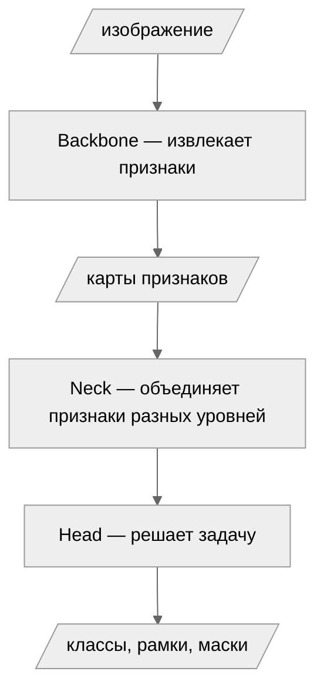
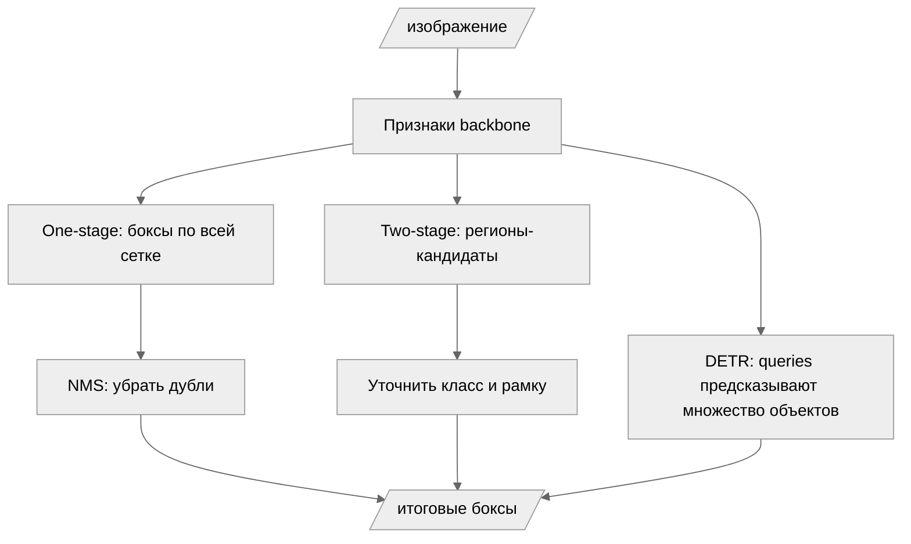
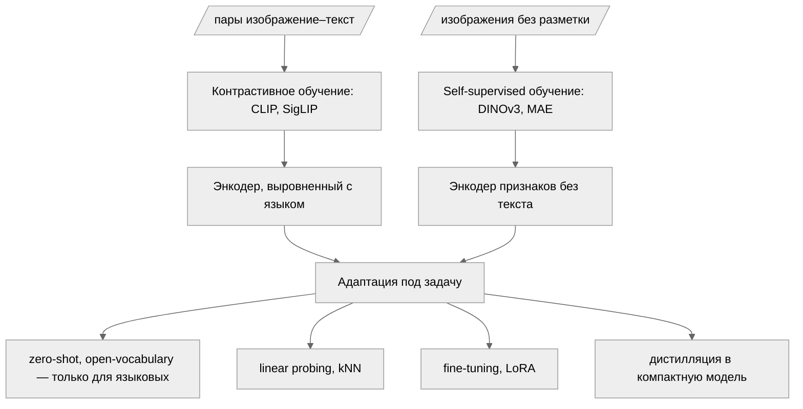

# Архитектуры моделей компьютерного зрения

Конспект отвечает на вопрос: из чего состоят модели из [таблицы задач](cv_tasks_models.md) и почему их так много. Генеративные модели здесь не рассматриваются.

## Из чего состоит модель: backbone, neck, head

Почти любая модель из таблицы задач устроена из трёх частей. **Backbone** — основная сеть, которая превращает изображение в карты признаков: на нижних уровнях это края и текстуры, на верхних — части объектов и целые объекты. **Neck** — промежуточный блок, который объединяет признаки разных уровней: мелкие объекты видны на нижних картах, крупные — на верхних, и задаче нужны оба. **Head** — небольшая сеть под конкретную задачу: она получает признаки и выдаёт классы, рамки или маски.



Разделение важно практическим: когда говорят «модель на ViT», имеют в виду backbone. Голову и neck часто заменяют или дообучают, оставляя backbone без изменений. Например, YOLO26 — это CNN-backbone, FPN-neck и головы сразу для нескольких задач (детекция, сегментация, позы); RT-DETR отличается от него в первую очередь трансформерным backbone.

## Словарь терминов

- `backbone` — основная сеть-извлекатель признаков
- `neck` — блок агрегации признаков между backbone и головой
- `head` — голова под конкретную задачу
- `embedding` (вектор признаков) — числовой вектор, который модель сопоставляет изображению или объекту; похожие изображения — близкие векторы
- `pretraining` — предобучение на большом датасете до решения конкретной задачи
- `fine-tuning` (дообучение) — продолжение обучения предобученной модели на своей задаче
- `transfer learning` (перенос обучения) — общий термин для использования предобученной модели в новой задаче
- `SSL` (self-supervised learning, самостоятельное обучение) — предобучение без разметки, метки модель порождает сама из данных
- `PEFT` (parameter-efficient fine-tuning) — дообучение малой части параметров: LoRA, адаптеры

## Две семьи бэкбонов

Историческая дуга короткая. До 2012 года признаки для изображений конструировали вручную (SIFT, HOG). В 2012 AlexNet показал, что свёрточная сеть, обученная на ImageNet, обходит ручные признаки — началась эра CNN. В 2015 ResNet решил проблему обучения глубоких сетей остаточными связями и стал стандартом на годы. В 2020 архитектуру Transformer из обработки текста перенесли на изображения (ViT) и одновременно применили к детекции (DETR). С 2021 года (CLIP) центр тяжести сместился от архитектур к способам предобучения на огромных данных — появились foundation models.

Семейства бэкбонов выглядят так:

```text
Бэкбоны
├── CNN
│   ├── классические: VGG, ResNet
│   ├── с управляемым масштабированием: EfficientNet
│   ├── современные: ConvNeXt — CNN, догнавшая ViT
│   └── мобильные: MobileNet — depthwise-свёртки, работа на CPU и edge
├── Трансформеры
│   ├── ViT — базовый: изображение как последовательность патчей
│   ├── Swin — иерархический: окна внимания, карты разных масштабов
│   └── DINOv3, MAE — архитектурно ViT, отличаются предобучением (см. ниже)
├── Гибриды: CvT, CoAtNet — свёртки внизу, внимание вверху
└── Альтернативы: MLP-Mixer, Vision Mamba (SSM)
```

CNN разбивают изображение локальными свёртками и наращивают поле зрения от слоя к слою. ViT делит изображение на патчи 16×16 пикселей и применяет attention ко всем патчам сразу — уже с первого слоя каждый патч «видит» всю сцену. Гибриды комбинируют оба подхода и на практике встречаются часто. MLP-Mixer полезен как иллюстрация того, что дело не только в attention: при достаточных данных и близкую точность показывает архитектура вообще без внимания. Vision Mamba и другие SSM-модели заменяют квадратичное по длине последовательности внимание линейным — это направление активно развивается, но в готовых продуктах пока встречается редко.

## Универсальные паттерны

Несколько идей пережили все смены парадигм и встречаются в архитектурах обеих семей — именно их стоит узнавать в любой новой модели.

**Остаточные связи (residual connections)** — слой обучается поправке к входу, а не полному преобразованию: выход = вход + f(вход). ResNet (2015) сделал благодаря этому обучаемыми сети в сотни слоёв; сегодня остаточные связи есть практически везде, включая трансформеры.

**Skip connections (соединения через уровни)** — в U-Net признаки с ранних слоёв передаются напрямую к декодеру в обход сжимающей части. Нижние слои хранят точную геометрию, и это критично для сегментации, где маска должна совпасть с границами объекта.

**Feature pyramid (пирамида признаков, FPN)** — neck, который выравнивает признаки разных уровней и отдаёт голове карты нескольких масштабов: мелкие объекты детектируются по нижним картам, крупные — по верхним. Стандарт для детекции и instance-сегментации.

**Attention (внимание)** — механизм взвешенного обмена информацией между элементами последовательности. В ViT элементы — патчи изображения, в DETR — обучаемые queries объектов. Идея одна и та же, меняется только то, что обменивается информацией.

**Encoder–decoder** — схема «сжать в компактное представление, затем развернуть до нужного выхода»: U-Net в сегментации, DETR в детекции, автоэнкодеры в извлечении признаков.

## Парадигмы решения задач

Одна и та же задача решается моделями, устроенными принципиально по-разному. Разберём детекцию — там различия самые наглядные.

### Детекция: one-stage, two-stage, DETR

| Подход | Идея | Сильные стороны | Модели |
|---|---|---|---|
| One-stage | сеть предсказывает боксы сразу по всей сетке признаков, затем NMS убирает дубли | скорость, простота развёртывания | YOLO-семейство, SSD |
| Two-stage | сначала найти регионы-кандидаты, затем уточнить в каждом класс и рамку | точность на плотных сценах | Faster R-CNN, Mask R-CNN |
| DETR | обучаемые queries напрямую предсказывают конечное множество объектов, NMS не нужна | простая постановка, легко добавлять новые задачи (сегментация, позы) | RT-DETR, D-FINE, RF-DETR |



Исторически модели шли от two-stage к one-stage ради скорости, а DETR (2020) предложил третий путь: детекция как предсказание множества (set prediction) с двусторонним сопоставлением предсказаний и разметки. Современные трансформерные детекторы (RT-DETR, D-FINE, RF-DETR) догнали YOLO по скорости, сохранив эту постановку.

### Сегментация: классификация пикселей против классификации масок

Два взгляда на задачу. При **классификации пикселей** (per-pixel classification) модель для каждого пикселя предсказывает метку класса — так работают U-Net, DeepLab, SegFormer. При **классификации масок** (mask classification) модель предсказывает множество масок, и к каждой маске прилагается класс — так работают Mask2Former, YOLO-seg и SAM. Второй подход универсальнее: одна и та же архитектура покрывает semantic-, instance- и panoptic-сегментацию, а SAM показывает его крайний случай — маски без классов вообще.

## Foundation models

Foundation model определяется не архитектурой — почти все они устроены как ViT, — а способом предобучения. Две семьи задают два разных набора возможностей.

**Выровненные с языком** (CLIP, SigLIP) обучаются контрастивно на сотнях миллионов пар изображение–текст: модель сближает векторы картинки и её описания. Из выравнивания с языком происходят все zero-shot и open-vocabulary возможности из таблицы задач: классы задаются текстом на этапе вывода.

**Self-supervised** (DINOv3, MAE, I-JEPA) обучаются на изображениях без разметки и без текста: например, MAE скрывает часть патчей и учит модель их восстанавливать. Такие энкодеры не знают слов, но дают сильные признаки для любой последующей задачи.



Способы адаптации — это и есть тот выбор, который делают в реальной работе. Если задача совпадает с возможностями модели, берут zero-shot без всякого обучения. Если нужен свой классификатор, часто достаточно kNN или линейной головы на замороженных признаках — это дёшево и не требует больших данных. Когда данных достаточно, дообучают модель целиком или через LoRA. Для продакшена на слабом железе энкодер дистиллируют в компактную модель — так устроен prompt-free режим YOLOE, где текстовый энкодер «запечён» в веса детектора.

## CNN против ViT: что выбрать

Разница семей — в индуктивных смещениях (inductive bias), то есть в том, что архитектура «знает» об изображениях заранее. CNN встроенной структурой предполагает локальность (соседние пиксели связаны) и сдвиговую эквивалентность (кот остаётся котом в любом месте кадра). Эти предположения верны и экономят данные: CNN хорошо обучается на небольших датасетах. ViT ничего не предполагает — отношения между патчами он выучивает сам, поэтому ему нужны либо большие данные, либо сильное предобучение.

Отсюда практический вывод, который снимает большую часть вопроса: сегодня обе семьи почти всегда берут предобученными, и выбор происходит между конкретными предобученными моделями, а не между «CNN или трансформер» в чистом виде. На малом датасете сильное предобучение важнее типа архитектуры. На очень большом масштабе трансформеры масштабируются лучше — поэтому все современные foundation-энкодеры построены на ViT.
